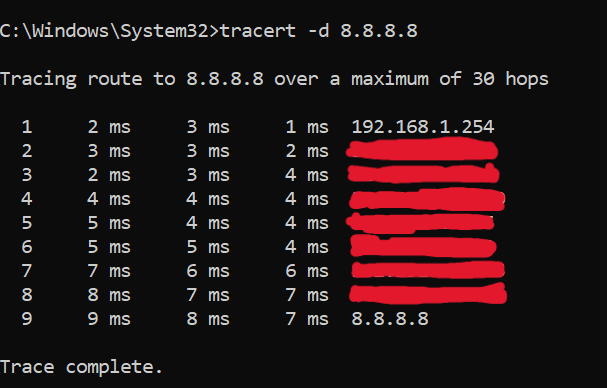
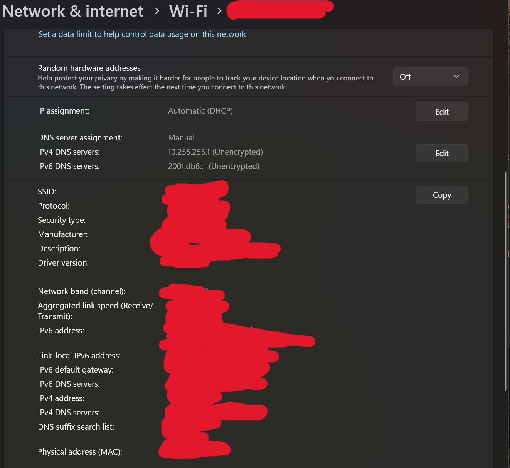
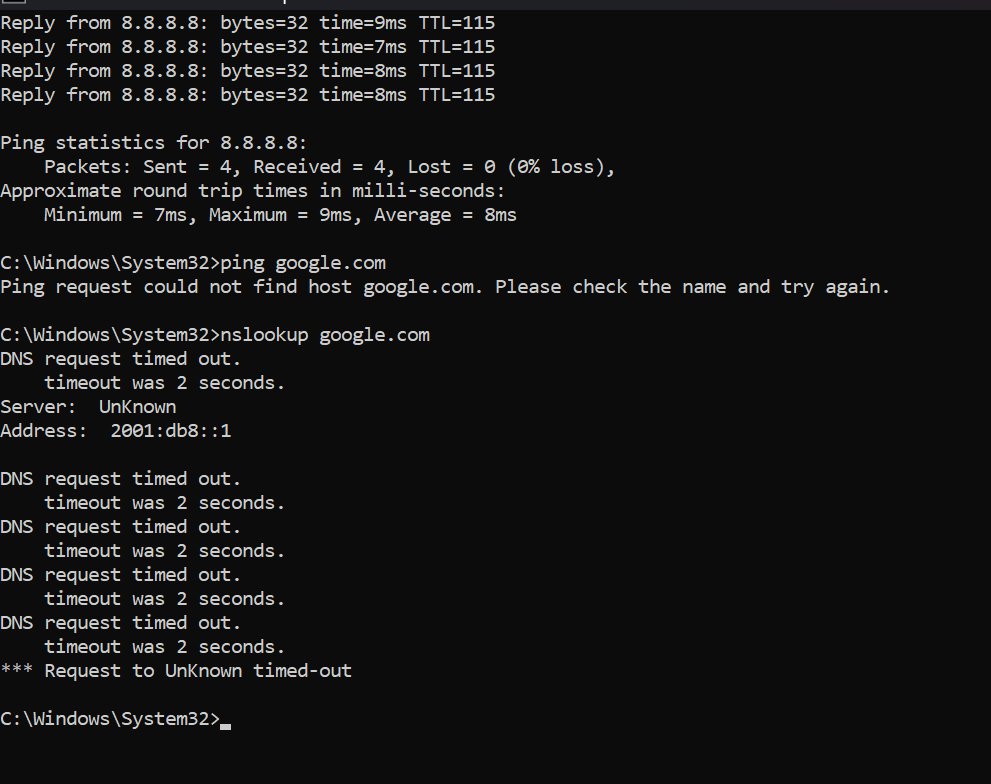
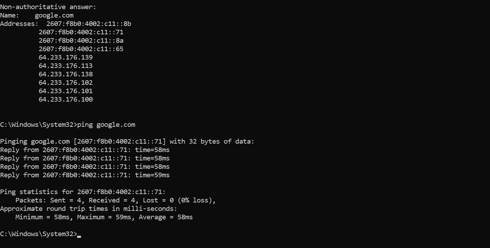

# Ticket 001: Websites not loading (DNS misconfiguration)

## Issue
User could not open websites.

## Environment
Windows 11, Wi-Fi.
Lab scenario: the issue was created on purpose for practice.

## Baseline Tests (before the issue)
1. Loopback: passed (`ping 127.0.0.1`)
2. Gateway: passed, average 1 ms
3. Internet by IP: passed, average 8 ms (`ping 8.8.8.8`)
4. DNS: passed (`nslookup google.com`)
5. Traceroute: completed, 9 hops (`tracert -d 8.8.8.8`)

## Tests During the Issue
1. `ping 8.8.8.8`: passed, 0% loss
2. `ping google.com`: failed, could not find host
3. `nslookup google.com`: failed, DNS request timed out

## Root Cause
DNS server assignment was changed to Manual with invalid DNS servers, so domain names could not be resolved.

## Resolution
Changed DNS server assignment back to Automatic (DHCP), then ran `ipconfig /flushdns` to clear the DNS cache.

## Verification
`nslookup google.com` returned Google's addresses, and `ping google.com` succeeded with 0% loss. A website loaded in the browser.

