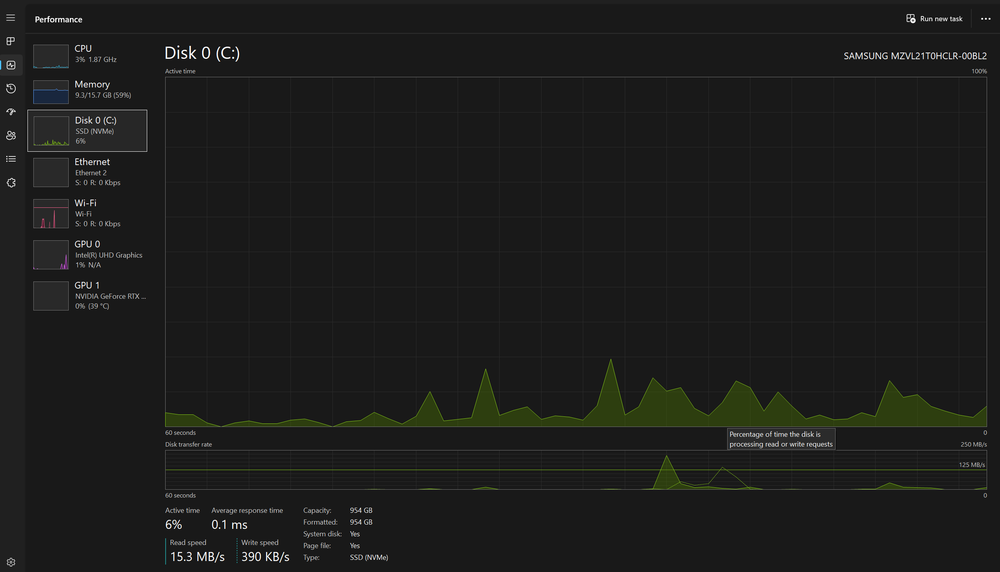
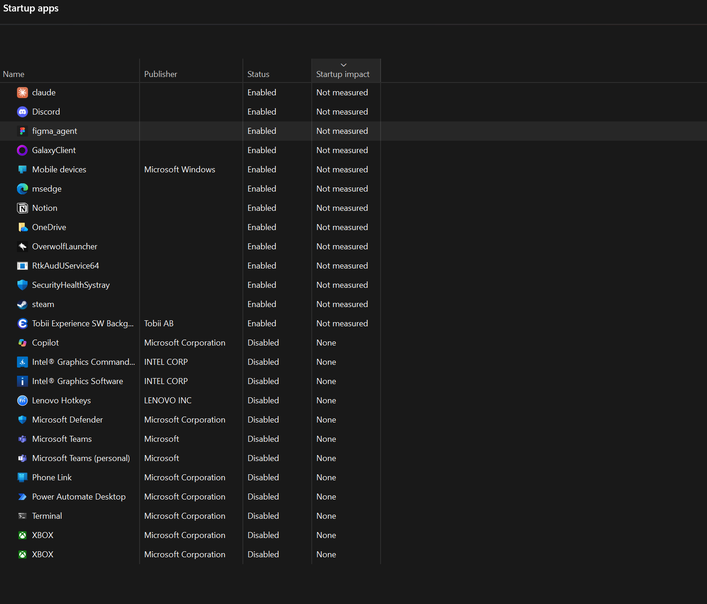
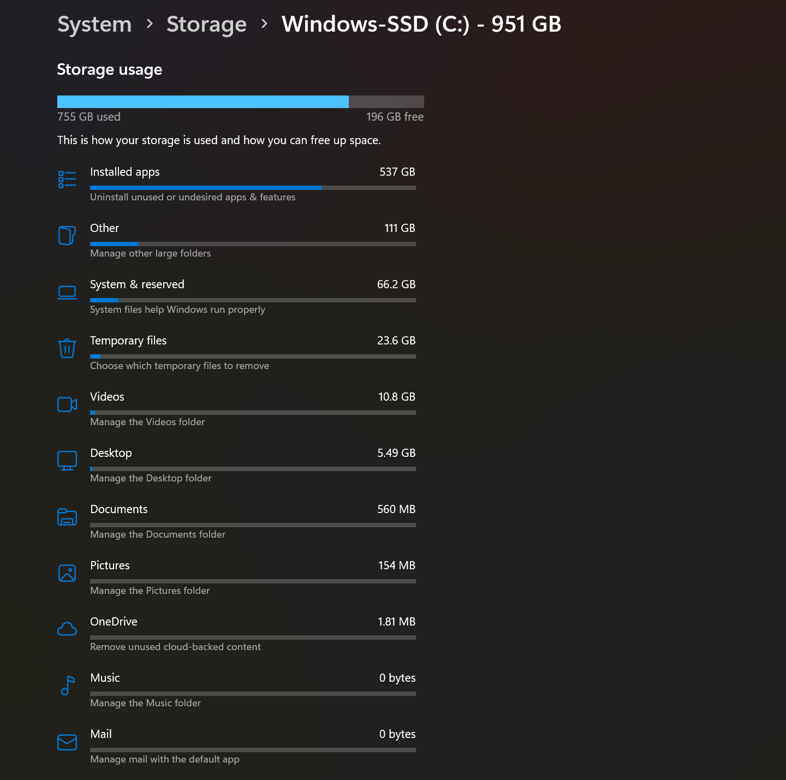
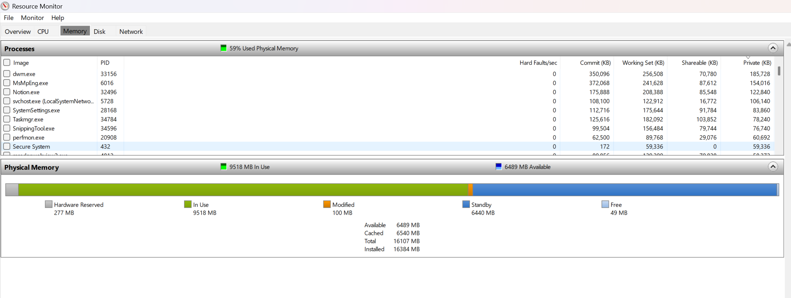
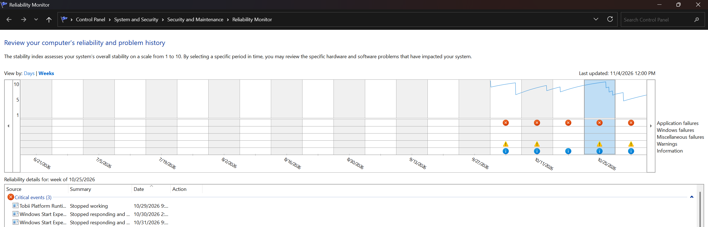
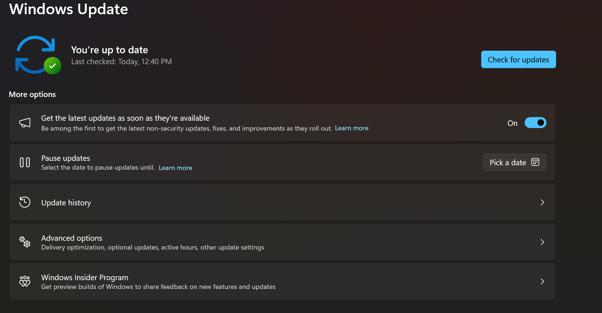
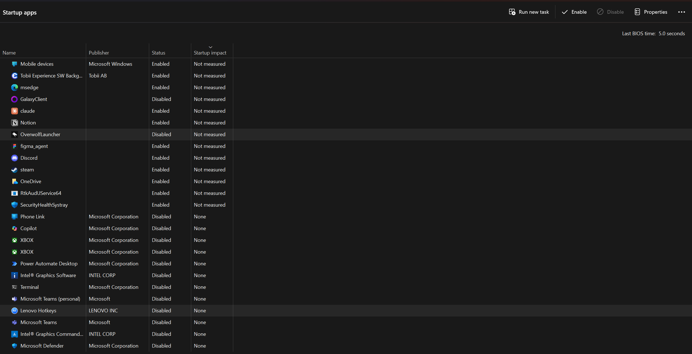
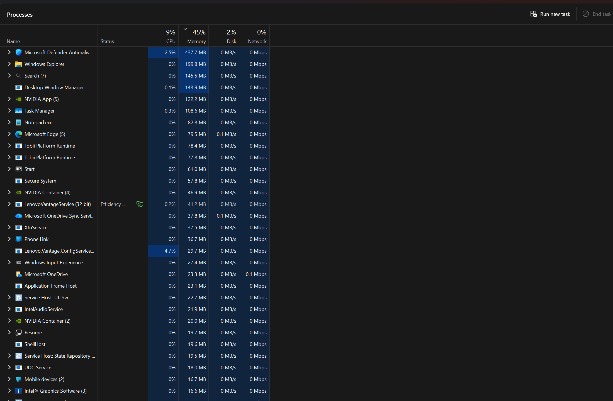

# Ticket 002: Slow computer investigation

## Issue
User reported that the computer felt slow.

## Environment
Windows 11, Lenovo laptop, 16 GB RAM, NVMe SSD.
Lab scenario: performance review on my own computer.

## Investigation
- Task Manager: CPU 1%, memory 60% (9.4 / 15.7 GB), disk 1-6%.
- Startup: 13 enabled apps; startup impact not measured.
- Storage: 196 GB free of 951 GB (about 21%).
- Resource Monitor: Hard Faults 0-8/sec, 6.4 GB available, disk active time 2-15%, queue length 0.00-0.03.
- Reliability Monitor, last 2 weeks: Tobii Platform Runtime (1), Windows Start Experience Host (2), and GOG Galaxy (2) critical events; 5 failed Store-related updates.
- Windows Update: up to date.

## Root Cause
No CPU, memory, disk, or storage bottleneck was found while the system was idle. The slowdown was not reproduced.

Windows Start Experience Host stopped responding on 10/30 and 10/31, shortly after Windows 11 26H2 (10/25) and a preview update (10/29). This is a possible correlation, not a confirmed cause.

## Resolution
- Installed pending Microsoft Store and Phone Link updates.
- Disabled GalaxyClient and OverwolfLauncher at startup.
- Kept security and audio startup items enabled.

## Verification
After restart: CPU 0%, memory 40%, disk 5%, and Last BIOS time 5.2 seconds. Both disabled apps remained disabled. Memory results are not directly comparable because fewer apps were open.

## Follow-up
Monitor Reliability Monitor for repeated Start Experience Host or Tobii events.
