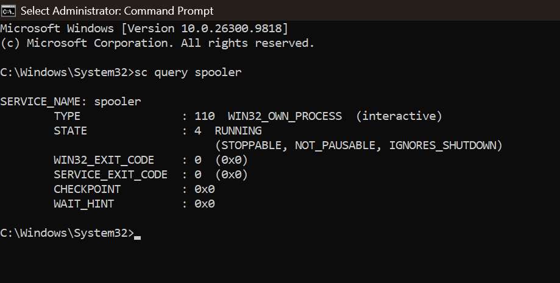
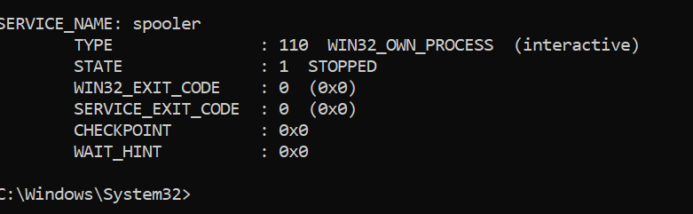
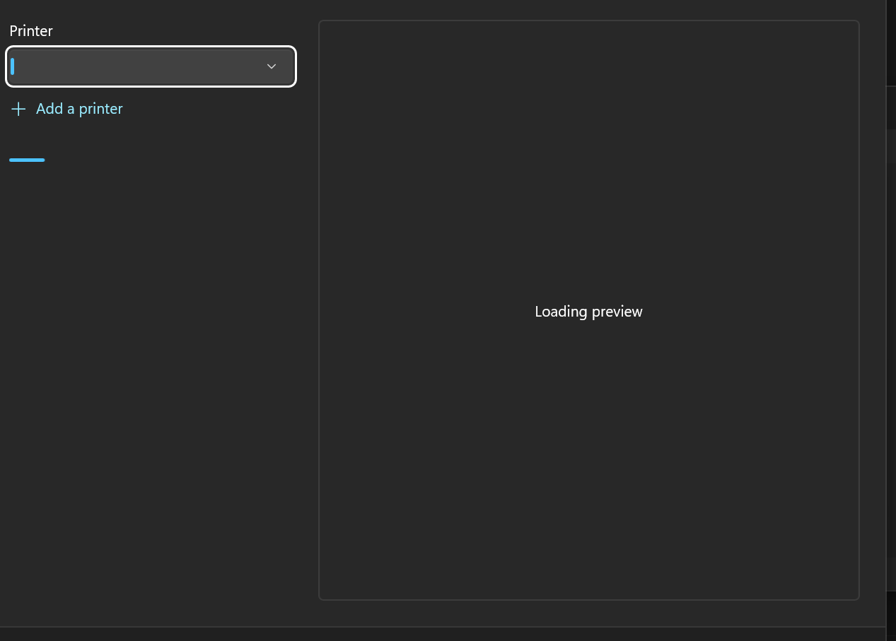
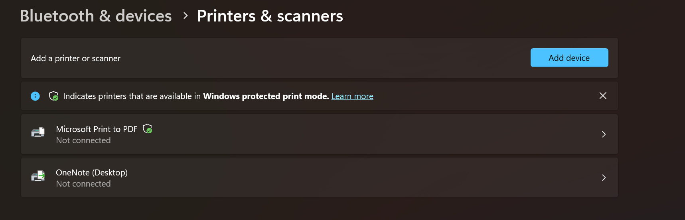
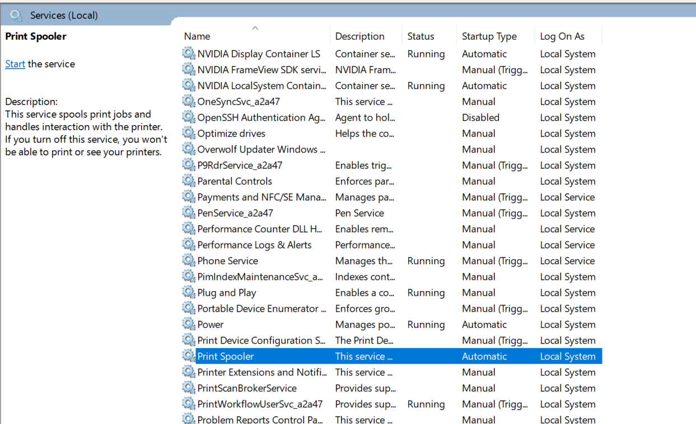
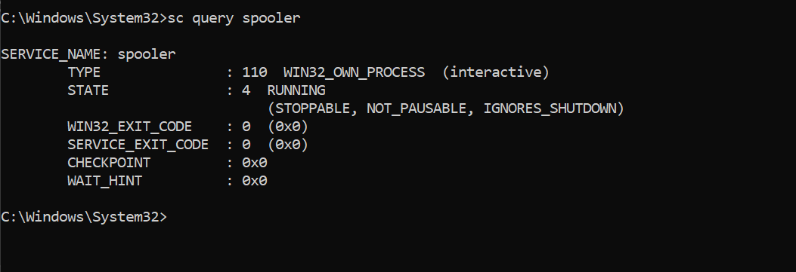
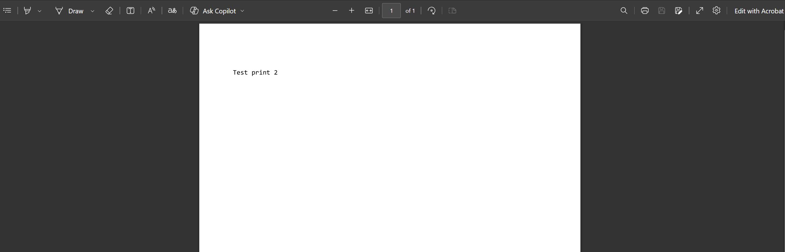

# Ticket 003: Unable to print (Print Spooler stopped)

## Issue
User reported that documents would not print.

## Environment
Windows 11, Microsoft Print to PDF.
Lab scenario: the issue was created on purpose for practice.

## Baseline
- Print Spooler status: RUNNING
- Printer status: Idle
- Test print to PDF: success

## Tests During the Issue
- `sc query spooler`: STOPPED
- Print dialog: no printer listed, preview stuck on Loading preview
- Printers & scanners: all printers showed Not connected
- Services: Print Spooler not running, Startup Type Automatic

## Root Cause
The Print Spooler service was stopped, so Windows could not process print jobs. All printers were affected, including the virtual PDF printer, which pointed to a system-wide print service issue rather than a problem with one printer.

## Resolution
Checked the spool folder before restarting the service. It contained two 0-byte files and no queued print data, so no cleanup was needed. Started the service with `net start spooler`.

## Verification
`sc query spooler` showed RUNNING. Printers no longer showed Not connected, and a test document printed to PDF and opened successfully.

