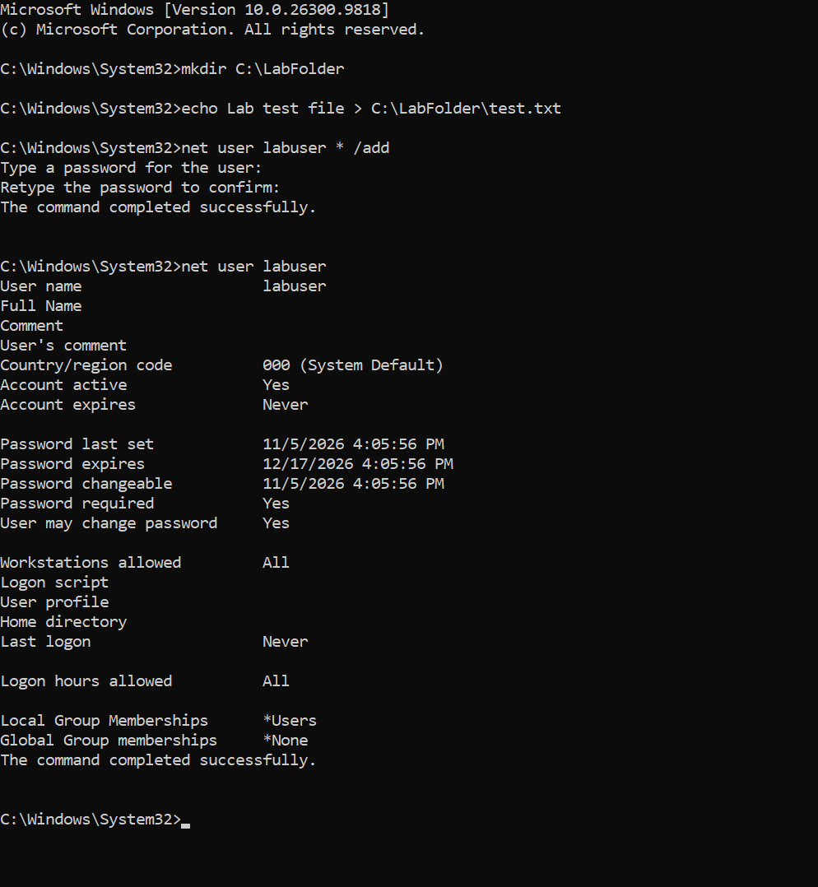
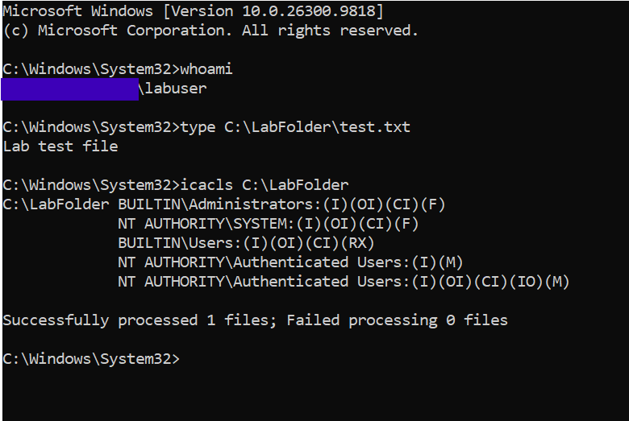
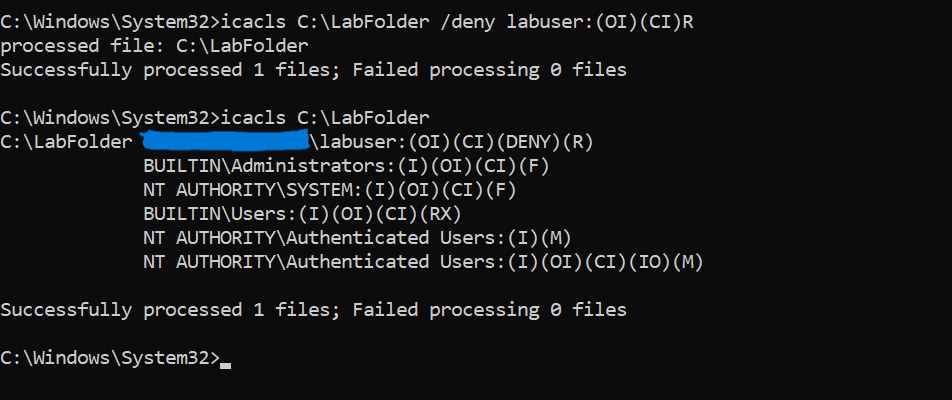
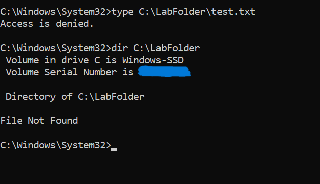
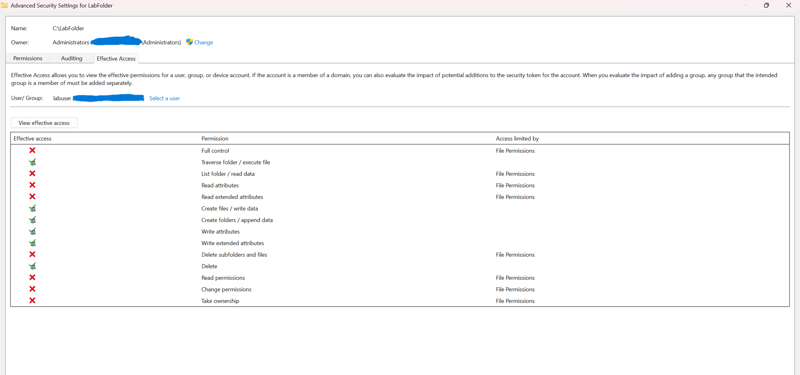
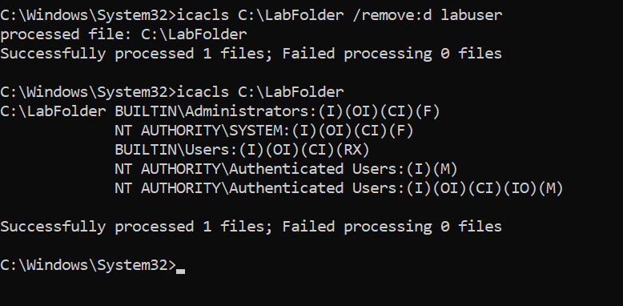
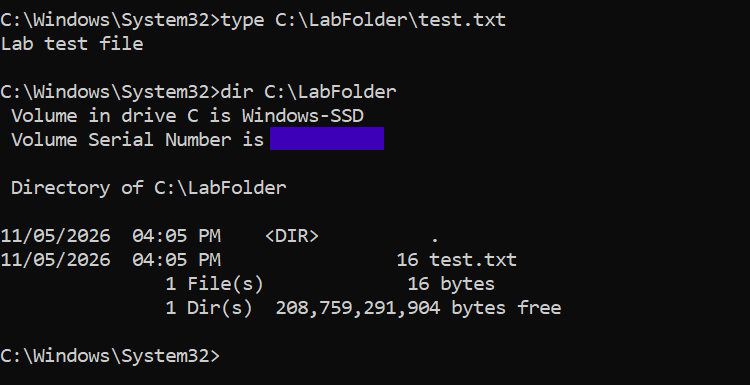
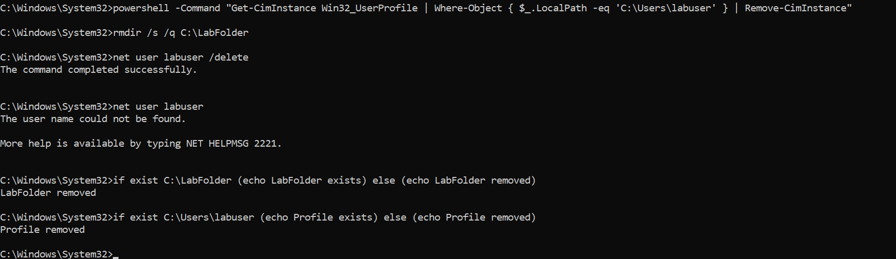

# Ticket 004: Access Denied to a Local Folder

> **Lab simulation:** This issue was created intentionally on my own Windows 11 computer using a temporary local account. No real user, company data, or production system was involved.

## Summary

| Field | Details |
|---|---|
| **Date** | November 5, 2026 |
| **Environment** | Windows 11, local NTFS volume |
| **Affected user** | `labuser` (temporary standard user) |
| **Affected resource** | `C:\LabFolder` |
| **Reported issue** | User cannot open a file in the folder |
| **Root cause** | Explicit NTFS Deny Read entry for the user |
| **Resolution** | Removed the Deny entry and verified access |
| **Status** | Resolved |

## User Report

> "I can't open the test file in LabFolder. It says Access is denied."

## Lab Setup

I created a test folder, a test file, and a standard local user:

```cmd
mkdir C:\LabFolder
echo Lab test file > C:\LabFolder\test.txt
net user labuser * /add
net user labuser
```

The account was active and belonged only to the local `Users` group. The password was not recorded.



## Baseline

I opened a separate Command Prompt as `labuser` and confirmed that the user could read the file:

```cmd
runas /user:labuser cmd
whoami
type C:\LabFolder\test.txt
icacls C:\LabFolder
```

| Principal | Permission | Source |
|---|---|---|
| Administrators | Full control (F) | Inherited |
| SYSTEM | Full control (F) | Inherited |
| Users | Read and execute (RX) | Inherited |
| Authenticated Users | Modify (M) | Inherited |

There were no Deny entries.



## Reproducing the Issue

From an administrator Command Prompt, I added an explicit Deny Read entry:

```cmd
icacls C:\LabFolder /deny labuser:(OI)(CI)R
icacls C:\LabFolder
```

The folder's permissions then included:

```text
labuser:(OI)(CI)(DENY)(R)
```



As `labuser`, I tested access again:

```cmd
type C:\LabFolder\test.txt
dir C:\LabFolder
```

- `type` returned `Access is denied.`
- `dir` returned `File Not Found`, even though the file still existed.

This showed that an error message may not identify the exact cause, so permissions must be checked directly.



## Diagnosis

I checked the folder in **Properties > Security > Advanced > Effective Access** and selected `labuser`.

Effective Access showed that the user was blocked from these permissions:

- List folder / read data
- Read attributes
- Read extended attributes
- Read permissions

Write-related permissions were still allowed. This matched the Deny entry, which blocked reading but not all access.

Full control, Change permissions, and Take ownership were also unavailable, but the user did not have those rights in the baseline.

**Root cause:** The explicit Deny Read entry overrode the Allow permissions that `labuser` received through group membership.



## Resolution

Because this Deny entry was created for the lab, I removed only that entry. In a real environment, I would first confirm that the restriction was not intentional and that the user was authorized to access the folder.

```cmd
icacls C:\LabFolder /remove:d labuser
icacls C:\LabFolder
```

The Deny entry was gone, and the inherited permissions were unchanged.



## Verification

As `labuser`, I repeated the original tests:

```cmd
type C:\LabFolder\test.txt
dir C:\LabFolder
```

- `type` displayed `Lab test file`.
- `dir` listed `test.txt`.



## Cleanup

I removed the temporary user profile, folder, and account, then verified that they no longer existed:

```cmd
powershell -Command "Get-CimInstance Win32_UserProfile | Where-Object { $_.LocalPath -eq 'C:\Users\labuser' } | Remove-CimInstance"
rmdir /s /q C:\LabFolder
net user labuser /delete
net user labuser
if exist C:\LabFolder (echo LabFolder exists) else (echo LabFolder removed)
if exist C:\Users\labuser (echo Profile exists) else (echo Profile removed)
```



## Lessons Learned

- `icacls` shows the permissions set on a folder, while Effective Access helps show the result for a specific user.
- An explicit Deny can block access even when the user receives Allow permissions through a group.
- Group membership and inherited permissions should both be checked when troubleshooting access.
- Before removing a restriction, confirm that it is not intentional and that the user is authorized.
- After a fix, test again as the affected user, not as an administrator.

## Skills Demonstrated

- NTFS permission troubleshooting
- Local user management
- Windows command line (`icacls`, `runas`, `net user`)
- Effective Access analysis
- Testing a fix from the user's account
- Technical documentation
