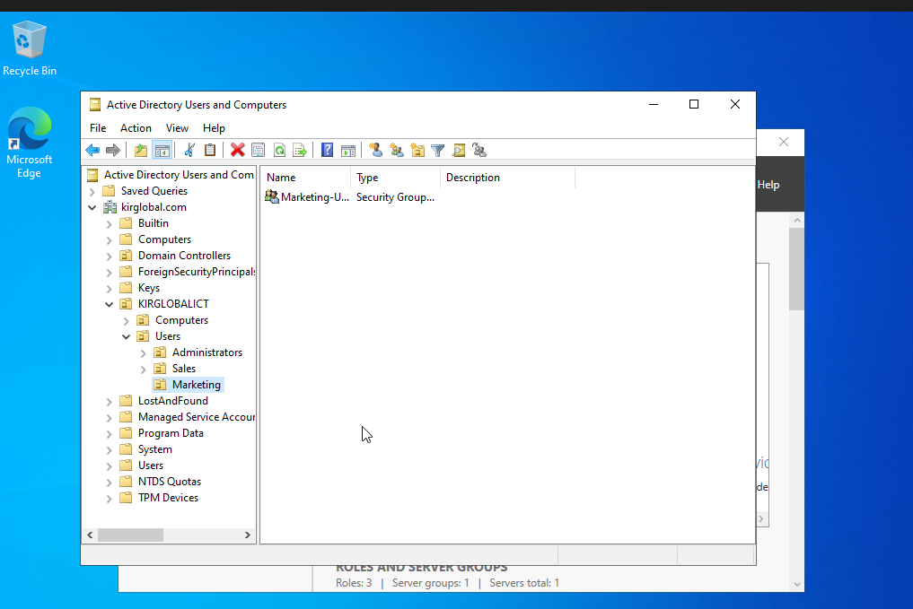
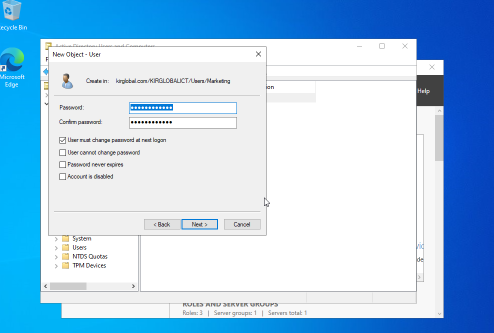
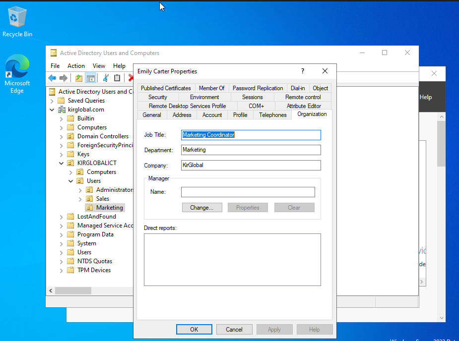
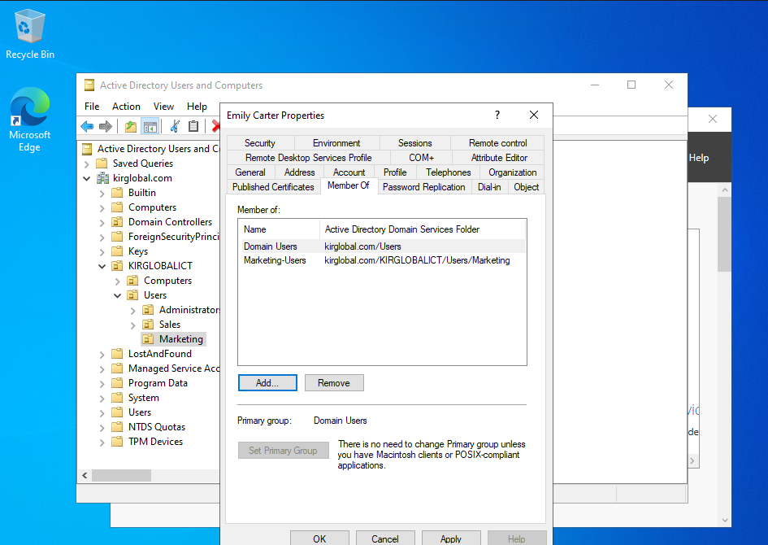
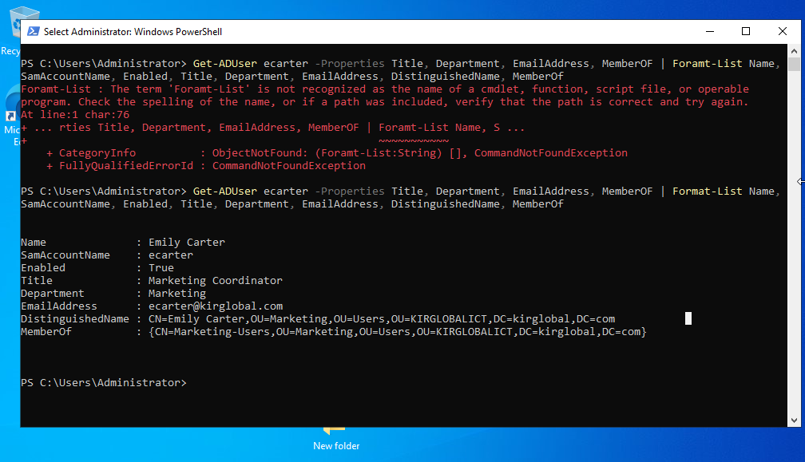
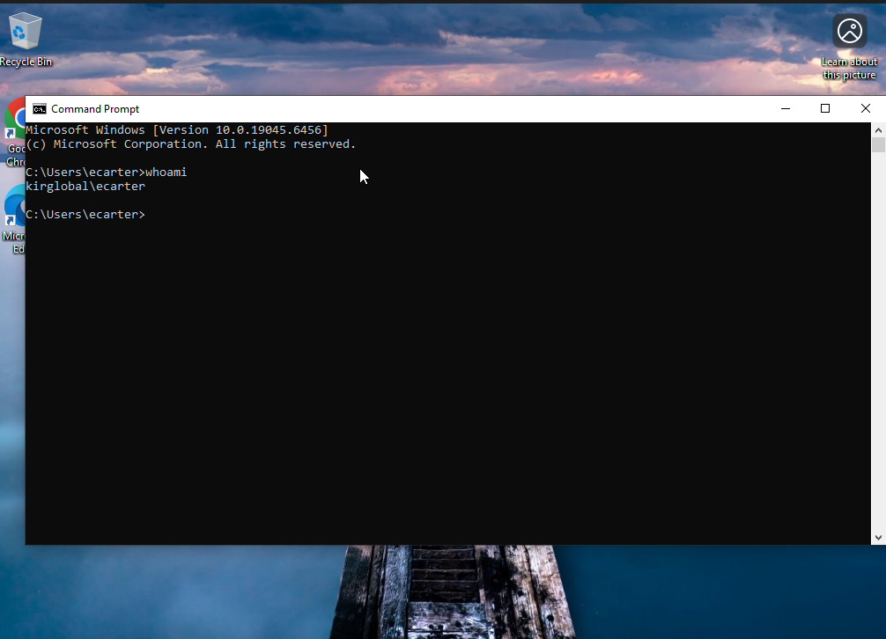

# TICKET-005 — New Hire Account Setup

| Field | Value |
|---|---|
| **Ticket ID** | TICKET-005 |
| **Category** | Account Management / Onboarding |
| **Priority** | Medium |
| **Requested by** | HR Department |
| **Assigned to** | Kirill Baev (IT Support, Tier 1) |
| **Status** | ✅ Resolved |
| **Environment** | Windows Server 2022 (DC011), Active Directory (`kirglobal.com`), Windows 11 client |

---

## Request

> New employee **Emily Carter** starts Monday in the **Marketing** department as a
> **Marketing Coordinator**. Please create a domain account, place it in the correct OU,
> and give her access to Marketing resources. She should set her own password at first login.

---

## Pre-checks

- Confirmed the request came from HR (approved onboarding request)
- Verified no existing account with the same name / username
- Applied naming convention: `first initial + last name` → `ecarter`
- Confirmed the department OU and security group exist:
  `KIRGLOBALICT > Users > Marketing` with group `Marketing-Users`



---

## Resolution Steps

### 1. Create the user account
**Active Directory Users and Computers** → `kirglobal.com > KIRGLOBALICT > Users > Marketing` → **New → User**

| Attribute | Value |
|---|---|
| First / Last name | Emily Carter |
| User logon name | `ecarter@kirglobal.com` |
| Temporary password | set per policy |
| User must change password at next logon | ☑ enabled |



### 2. Fill in employee details
**Properties → General / Organization**

| Field | Value |
|---|---|
| Job Title | Marketing Coordinator |
| Department | Marketing |
| Company | KirGlobal |
| E-mail | ecarter@kirglobal.com |



### 3. Grant access via security group
**Properties → Member Of → Add** → `Marketing-Users`



---

## Verification

### Account check (PowerShell)

```powershell
Get-ADUser ecarter -Properties Title, Department, EmailAddress, MemberOf |
  Format-List Name, SamAccountName, Enabled, Title, Department, EmailAddress, DistinguishedName, MemberOf
```

```
Name              : Emily Carter
SamAccountName    : ecarter
Enabled           : True
Title             : Marketing Coordinator
Department        : Marketing
EmailAddress      : ecarter@kirglobal.com
DistinguishedName : CN=Emily Carter,OU=Marketing,OU=Users,OU=KIRGLOBALICT,DC=kirglobal,DC=com
MemberOf          : {CN=Marketing-Users,OU=Marketing,OU=Users,OU=KIRGLOBALICT,DC=kirglobal,DC=com}
```



### Login test on domain-joined client
- Signed in on the Windows 11 client as `kirglobal\ecarter`
- User was prompted to change the temporary password ✅
- `whoami` confirms the domain session



---

## Issue Encountered

**Problem:** While organizing the lab, moving the `Marketing` OU into
`KIRGLOBALICT > Users` failed with *"Windows cannot move object Marketing because: Access is denied."*

**Cause:** The OU had **Protect object from accidental deletion** enabled (default for new OUs),
which also blocks moving it.

**Fix:** View → Advanced Features → OU Properties → Object tab → temporarily cleared
the protection flag → moved the OU → **re-enabled protection**.

---

## Resolution Summary

Created domain account `ecarter` for a new Marketing employee, placed it in the
`Marketing` OU, populated job details, and granted access through the `Marketing-Users`
security group. Temporary password with forced change at first logon.
Verified with `Get-ADUser` and a successful test login on a domain-joined client.

## Skills Demonstrated
Active Directory Users and Computers · OU design · Security groups (RBAC) ·
PowerShell (`Get-ADUser`) · Onboarding workflow · Password policy best practices ·
Troubleshooting (OU accidental-deletion protection)
