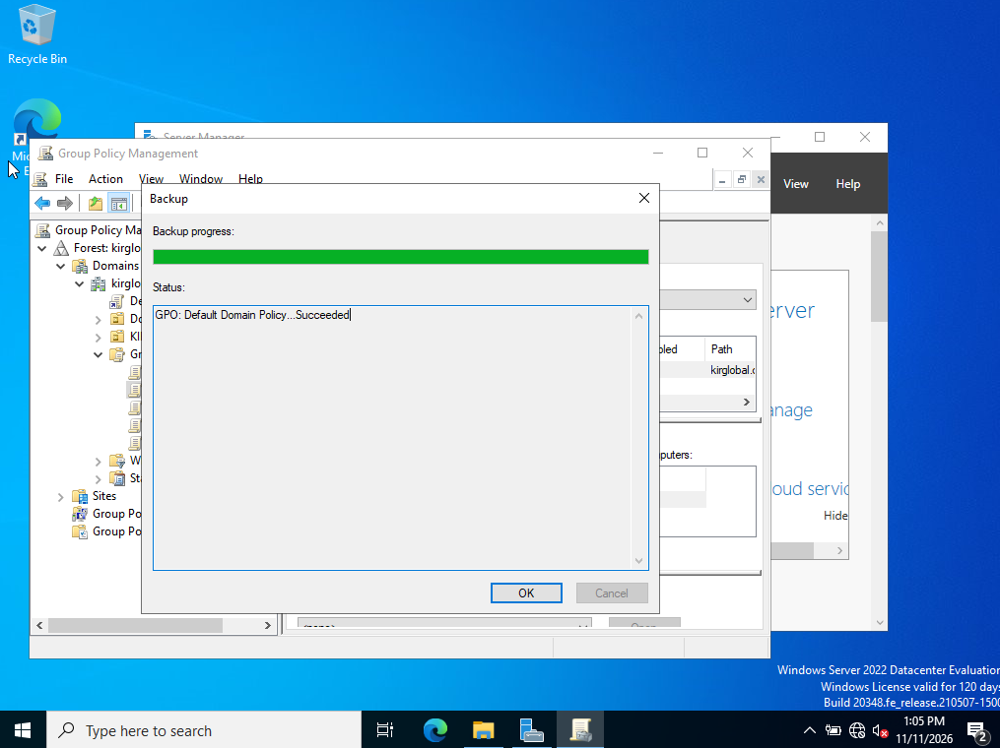
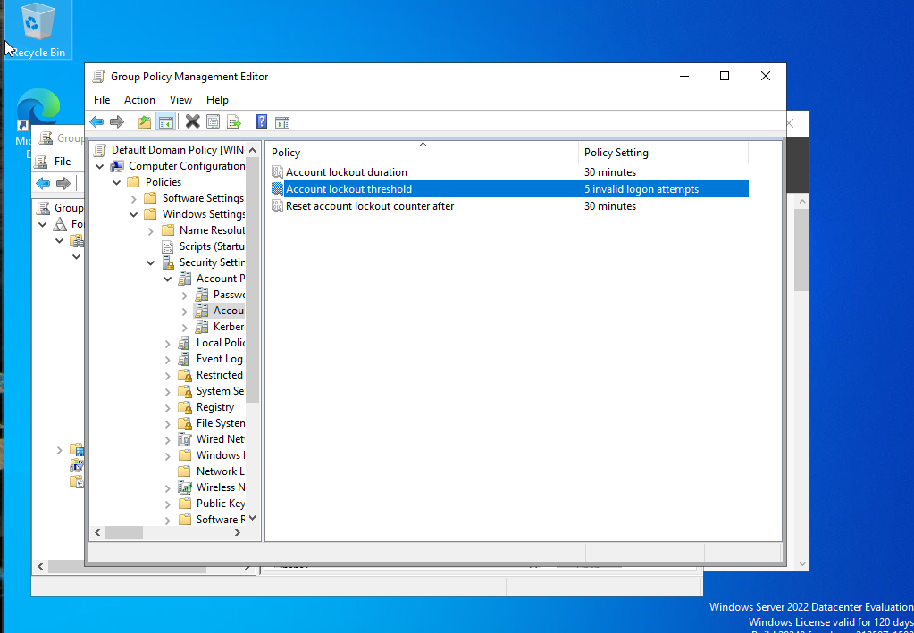
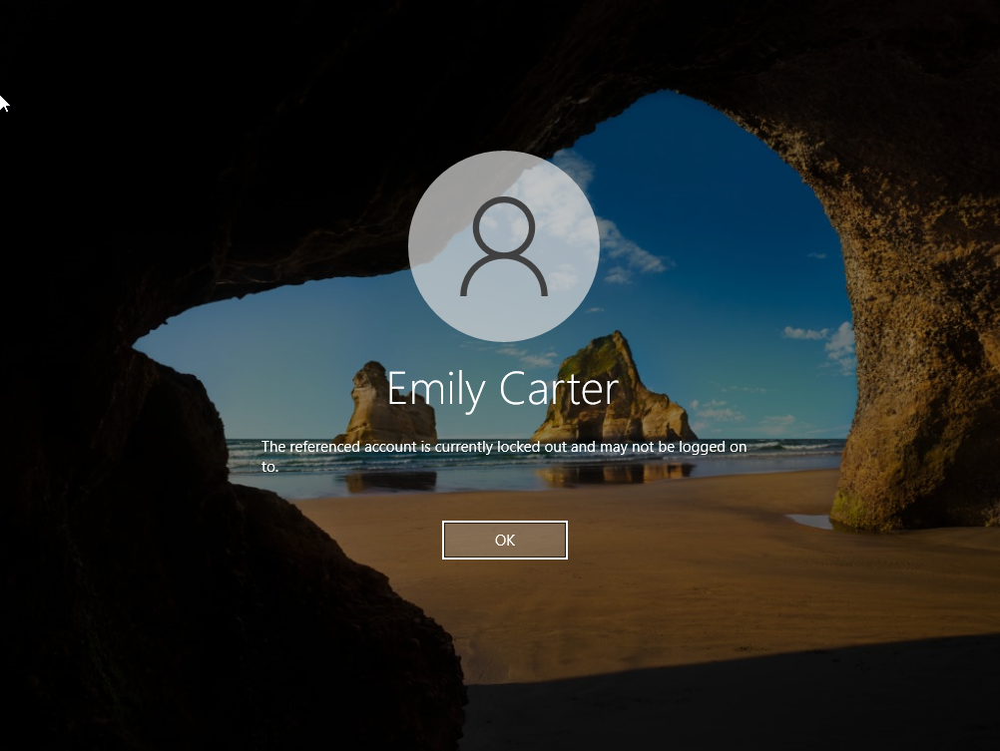
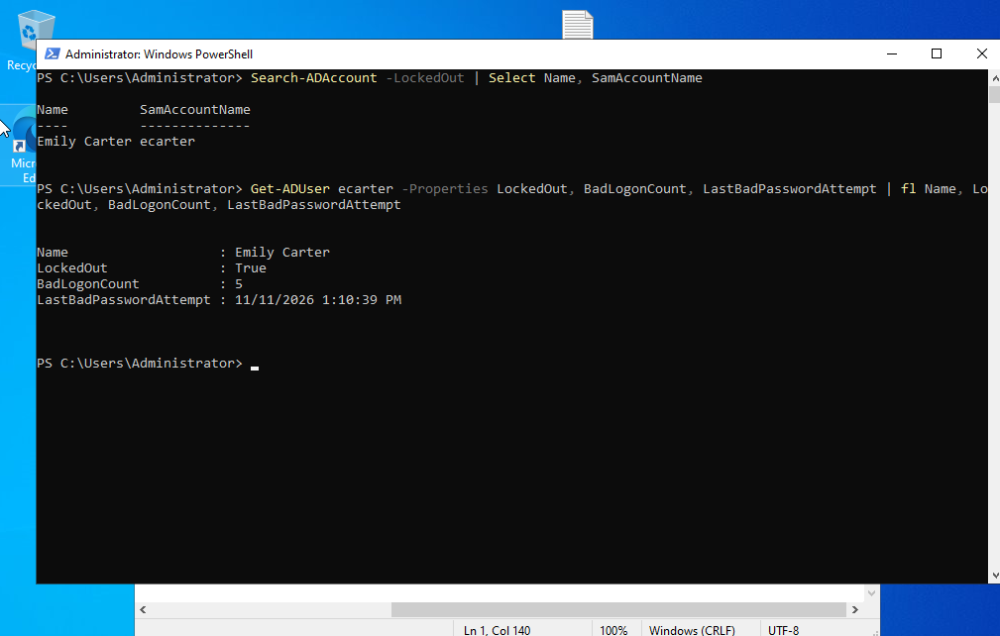
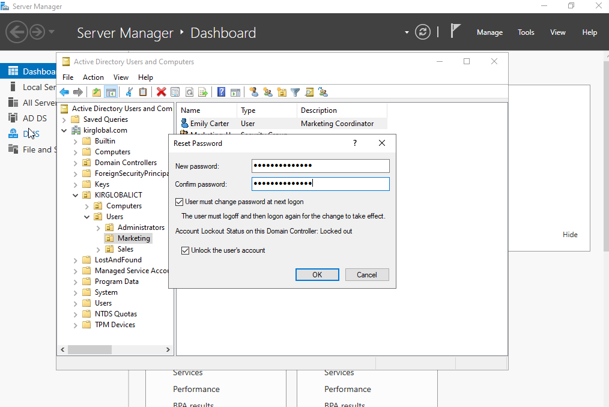
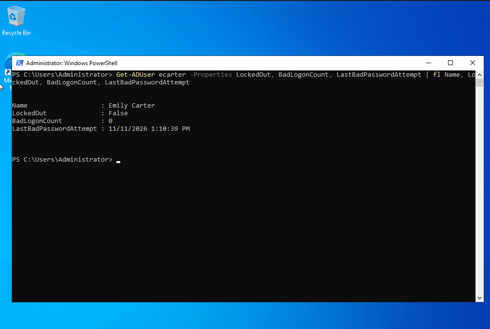
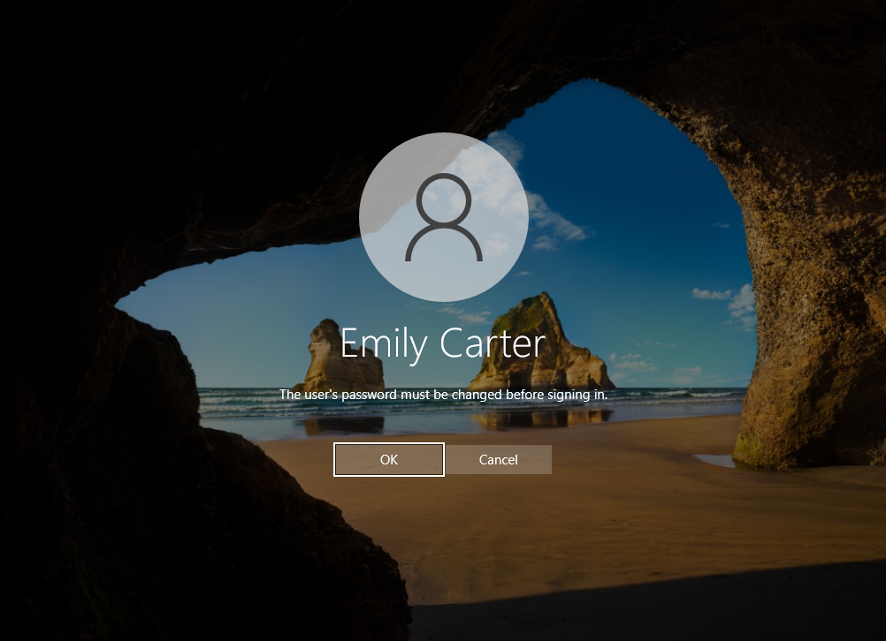

# TICKET-006 — Account Locked Out / Password Reset

| Field | Value |
|---|---|
| **Ticket ID** | TICKET-006 |
| **Category** | Account Management / Access Issue |
| **Priority** | High (user unable to work) |
| **Requested by** | Emily Carter (Marketing) |
| **Assigned to** | Kirill Baev (IT Support, Tier 1) |
| **Status** | ✅ Resolved |
| **Environment** | Windows Server 2022 (DC011), Active Directory (`kirglobal.com`), Windows 10 client |

---

## Request

> *"Hi, I can't log in to my computer. I think I forgot my new password and tried a few times,
> now it says my account is locked. Can you help?"* — Emily Carter, Marketing

---

## Background — Enabling Account Lockout Policy

By default, a new AD domain has **no account lockout threshold** (`0` = never lock out),
which leaves accounts open to password-guessing / brute-force attacks.
Before this scenario, an account lockout policy was configured at the domain level.

### Pre-change: GPO backup
Before editing **Default Domain Policy**, a backup was taken so the change can be rolled back.

**Group Policy Management** → `Group Policy Objects` → **Default Domain Policy** → **Back Up...**
- Location: `C:\GPOBackups`
- Description: *Pre-change backup before enabling account lockout policy*



> **Note:** Password and lockout policies for domain accounts only take effect from a GPO
> linked at the **domain root** (Default Domain Policy) — not from *Default Domain Controllers Policy*.

### Change: Account Lockout Policy
`Computer Configuration → Policies → Windows Settings → Security Settings → Account Policies → Account Lockout Policy`

| Policy | Setting |
|---|---|
| Account lockout threshold | 5 invalid logon attempts |
| Account lockout duration | 30 minutes |
| Reset account lockout counter after | 30 minutes |



Applied with `gpupdate /force` on the domain controller.

---

## Issue Reproduced

Entered an incorrect password 5 times on the Windows 10 client as `kirglobal\ecarter`:



---

## Diagnosis

Confirmed the lockout on the domain controller:

```powershell
# All locked-out accounts in the domain
Search-ADAccount -LockedOut | Select Name, SamAccountName

# Details for the affected user
Get-ADUser ecarter -Properties LockedOut, BadLogonCount, LastBadPasswordAttempt |
  fl Name, LockedOut, BadLogonCount, LastBadPasswordAttempt
```

```
Name                   : Emily Carter
LockedOut              : True
BadLogonCount          : 5
LastBadPasswordAttempt : 11/11/2026 1:10:39 PM
```



**Root cause:** User forgot her password; 5 failed attempts triggered the lockout policy.
Not a security incident — failed attempts came from her own workstation at the time she reported.

---

## Resolution Steps

### 1. Verify the caller's identity
Before any password reset, the user's identity was verified (e.g., employee ID / callback
to the number on file / manager confirmation) to prevent social-engineering attacks.

### 2. Reset password and unlock account
**ADUC** → `KIRGLOBALICT > Users > Marketing` → right-click **Emily Carter** → **Reset Password...**
- New temporary password set
- ☑ User must change password at next logon
- ☑ Unlock the user's account *(status shown: Locked out)*



### PowerShell equivalent

```powershell
Unlock-ADAccount -Identity ecarter
Set-ADAccountPassword -Identity ecarter -Reset `
  -NewPassword (Read-Host -AsSecureString "Temp password")
Set-ADUser -Identity ecarter -ChangePasswordAtLogon $true
```

---

## Verification

**Server side** — account no longer locked, bad logon counter reset:

```
Name                   : Emily Carter
LockedOut              : False
BadLogonCount          : 0
```



**Client side** — user signed in with the temporary password and was required to set a new one:



User confirmed she can log in. ✅

---

## Resolution Summary

User was locked out after 5 failed logon attempts due to a forgotten password.
Verified identity, confirmed lockout via PowerShell, reset the password with
forced change at next logon, and unlocked the account. Verified on both the DC and the client.

**Time to resolve:** ~10 min

## Skills Demonstrated
Group Policy Management (GPO backup, Account Lockout Policy) · Active Directory Users and Computers ·
PowerShell (`Search-ADAccount`, `Get-ADUser`, `Unlock-ADAccount`, `Set-ADAccountPassword`) ·
Identity verification · Password reset best practices · Change management (backup before change)
