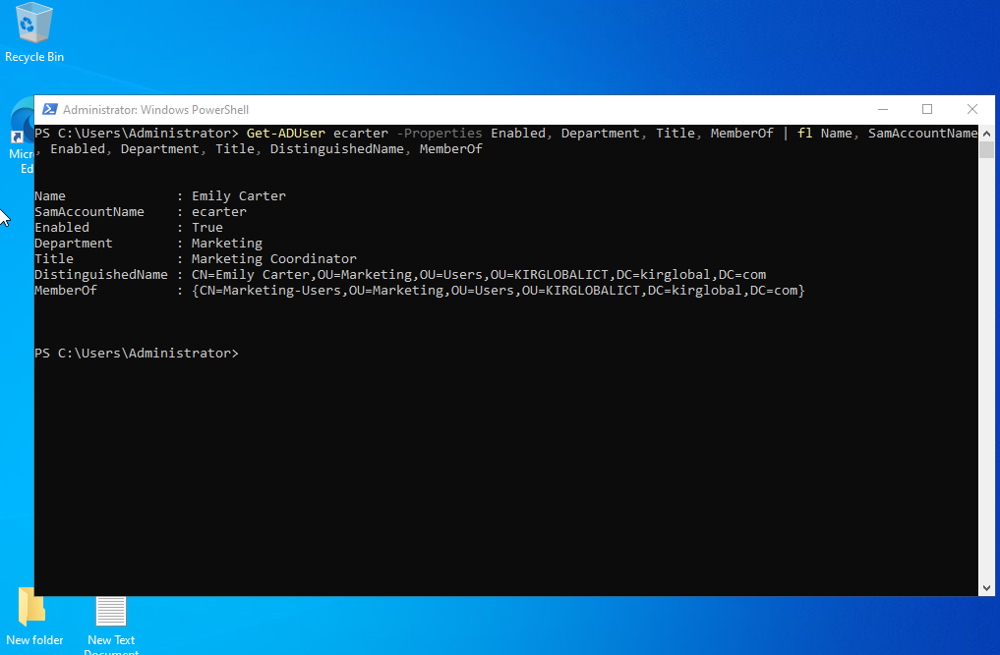
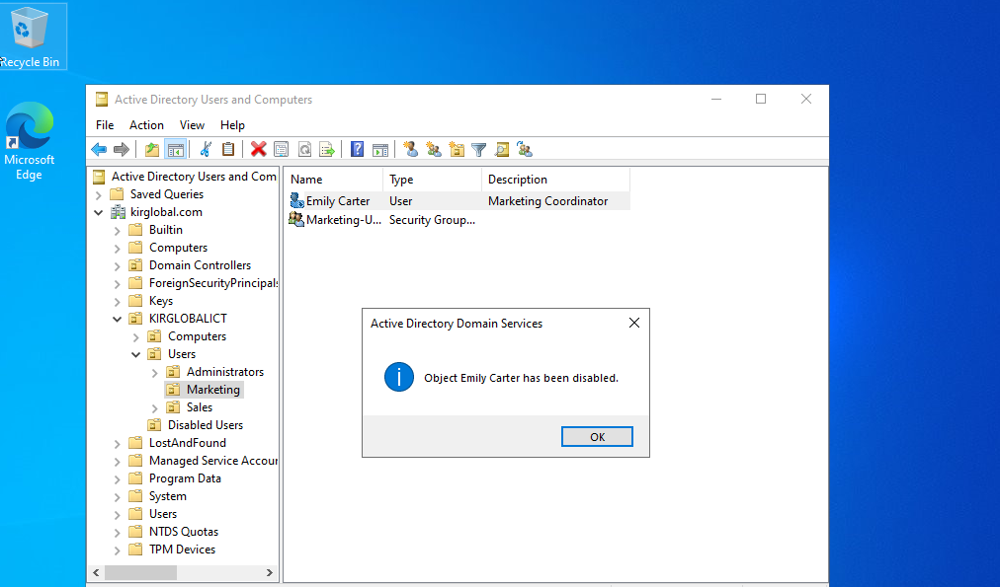
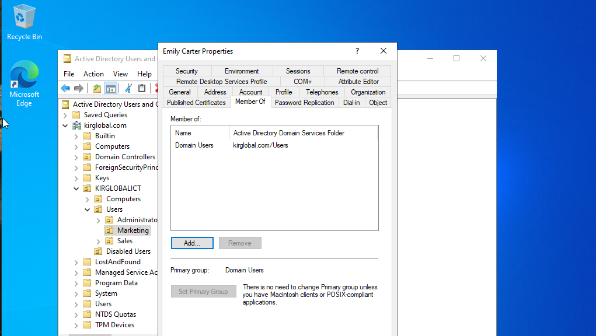
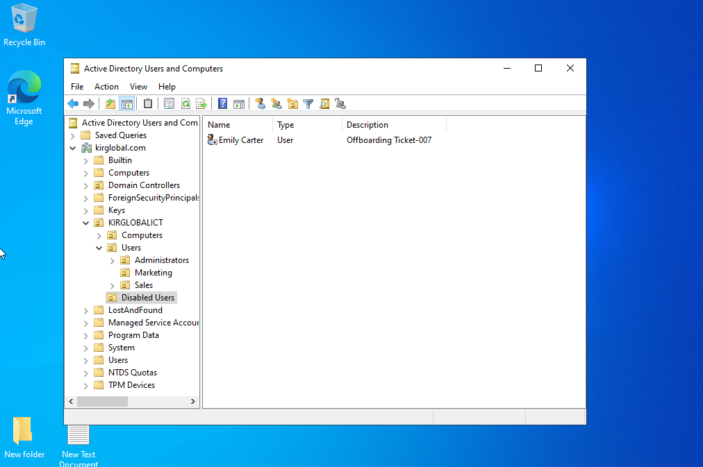
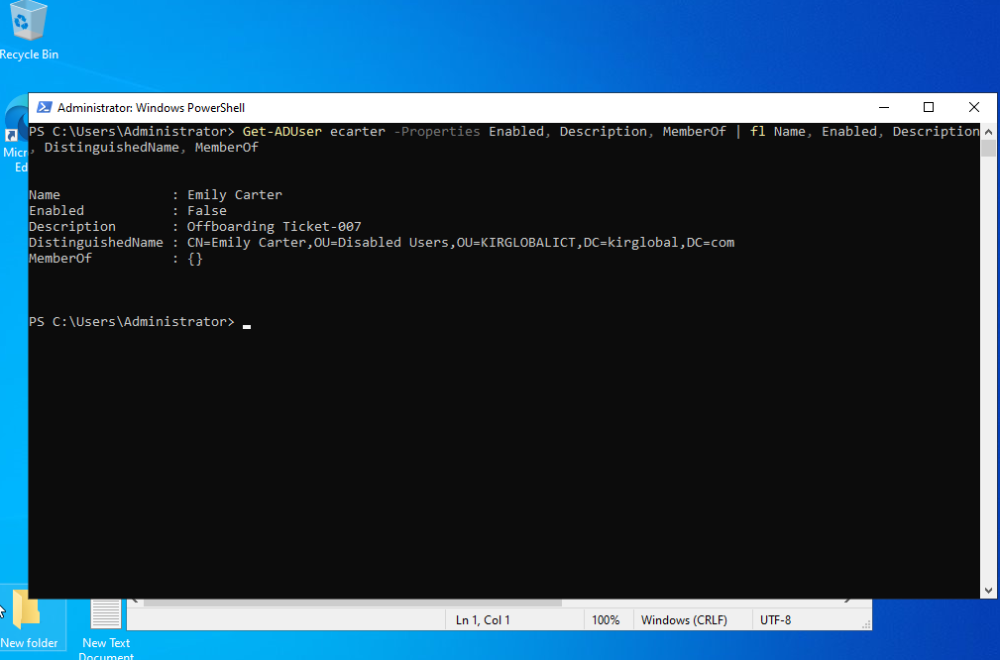
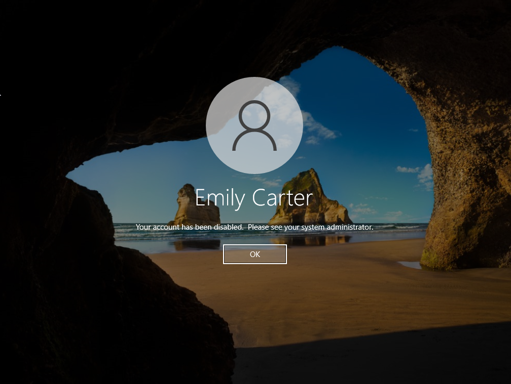

# TICKET-007 — Employee Offboarding

| Field | Value |
|---|---|
| **Ticket ID** | TICKET-007 |
| **Category** | Account Management / Offboarding |
| **Priority** | High (security — same-day access removal) |
| **Requested by** | HR Department |
| **Assigned to** | Kirill Baev (IT Support, Tier 1) |
| **Status** | ✅ Resolved |
| **Environment** | Windows Server 2022 (DC011), Active Directory (`kirglobal.com`), Windows 10 client |

---

## Request

> **Emily Carter** (Marketing Coordinator) is leaving the company effective today.
> Please remove her access to company systems. Her manager may need access
> to her files later, so do not delete the account yet.

---

## Pre-checks

- Confirmed the request came from HR with an effective termination date
- Created a dedicated OU for offboarded accounts (one-time setup):
  `KIRGLOBALICT > Disabled Users`
- Documented the user's current access **before** making changes
  (needed if access must be transferred to a replacement)

```powershell
Get-ADUser ecarter -Properties Enabled, Department, Title, MemberOf |
  fl Name, SamAccountName, Enabled, Department, Title, DistinguishedName, MemberOf
```

```
Name              : Emily Carter
SamAccountName    : ecarter
Enabled           : True
Department        : Marketing
Title             : Marketing Coordinator
DistinguishedName : CN=Emily Carter,OU=Marketing,OU=Users,OU=KIRGLOBALICT,DC=kirglobal,DC=com
MemberOf          : {CN=Marketing-Users,OU=Marketing,OU=Users,OU=KIRGLOBALICT,DC=kirglobal,DC=com}
```



---

## Resolution Steps

### 1. Disable the account
**ADUC** → `KIRGLOBALICT > Users > Marketing` → right-click **Emily Carter** → **Disable Account**



> **Why disable instead of delete?** Deleting removes the account's SID — access to her files,
> mailbox and audit history would be lost. Accounts are kept disabled and deleted later
> according to the company retention policy (typically 30–90 days).

### 2. Remove group memberships
**Properties → Member Of** → removed `Marketing-Users`.
`Domain Users` remains (primary group — cannot be removed).



### 3. Tag the account
**Properties → General → Description:**
`Offboarding Ticket-007`

So any admin can trace why the account is disabled and not re-enable it by mistake.

### 4. Move to Disabled Users OU
Right-click → **Move...** → `KIRGLOBALICT > Disabled Users`



### PowerShell equivalent

```powershell
Disable-ADAccount -Identity ecarter
Remove-ADGroupMember -Identity "Marketing-Users" -Members ecarter -Confirm:$false
Set-ADUser ecarter -Description "Offboarding Ticket-007"
Get-ADUser ecarter | Move-ADObject -TargetPath "OU=Disabled Users,OU=KIRGLOBALICT,DC=kirglobal,DC=com"
```

---

## Verification

**Server side:**

```powershell
Get-ADUser ecarter -Properties Enabled, Description, MemberOf |
  fl Name, Enabled, Description, DistinguishedName, MemberOf
```

- `Enabled : False` ✅
- Description references the offboarding ticket ✅
- Located in `OU=Disabled Users` ✅
- No remaining group memberships besides the primary group ✅



**Client side** — login attempt as `kirglobal\ecarter` is blocked:
*"Your account has been disabled. Please see your system administrator."*



---

## Resolution Summary

Offboarded departing employee Emily Carter: documented her access, disabled the account,
removed group memberships, tagged it with the ticket number, and moved it
to the `Disabled Users` OU. The account was retained (not deleted) so her data remains
recoverable. Verified via PowerShell and a blocked login attempt on the client.

**Time to resolve:** ~10 min

## Follow-up (in a real environment)
- Delete the account after the retention period (e.g. 30 days) per policy
- Transfer file / mailbox access to the manager if requested
- Collect company equipment, revoke VPN / MFA / SaaS access

## Skills Demonstrated
Offboarding workflow · Active Directory Users and Computers · OU design ·
Least privilege / access removal · PowerShell (`Disable-ADAccount`, `Remove-ADGroupMember`,
`Set-ADUser`, `Move-ADObject`) · Documentation and audit trail
