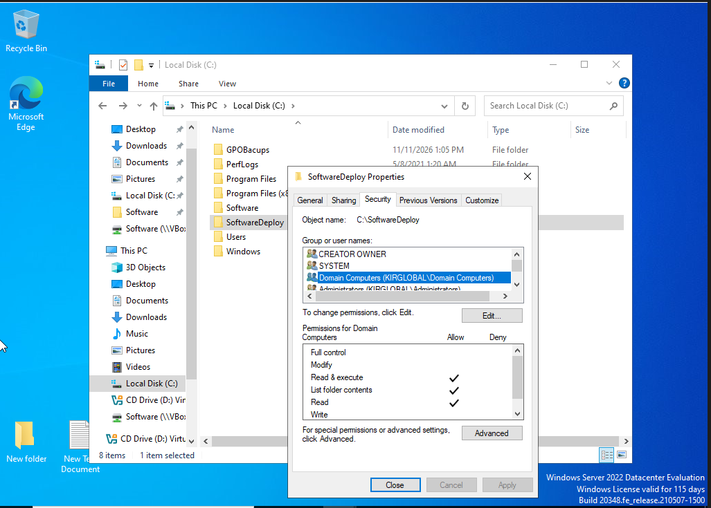
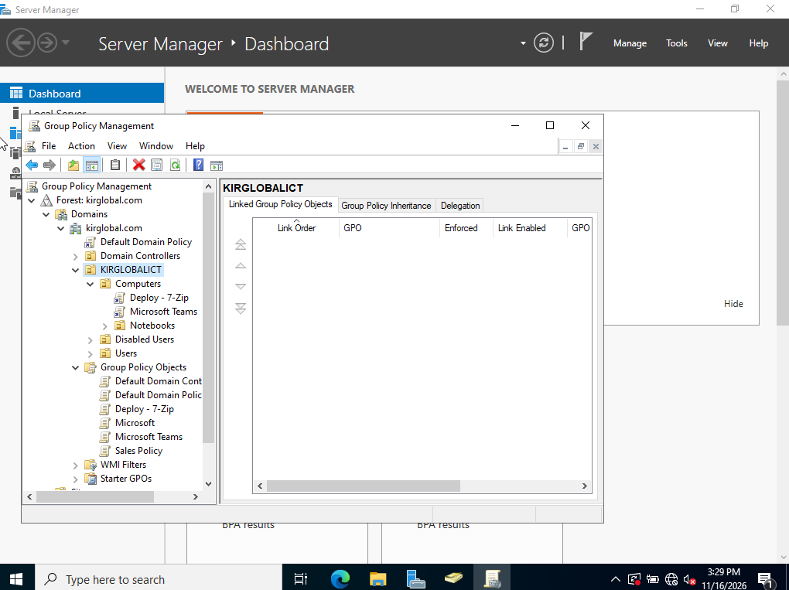
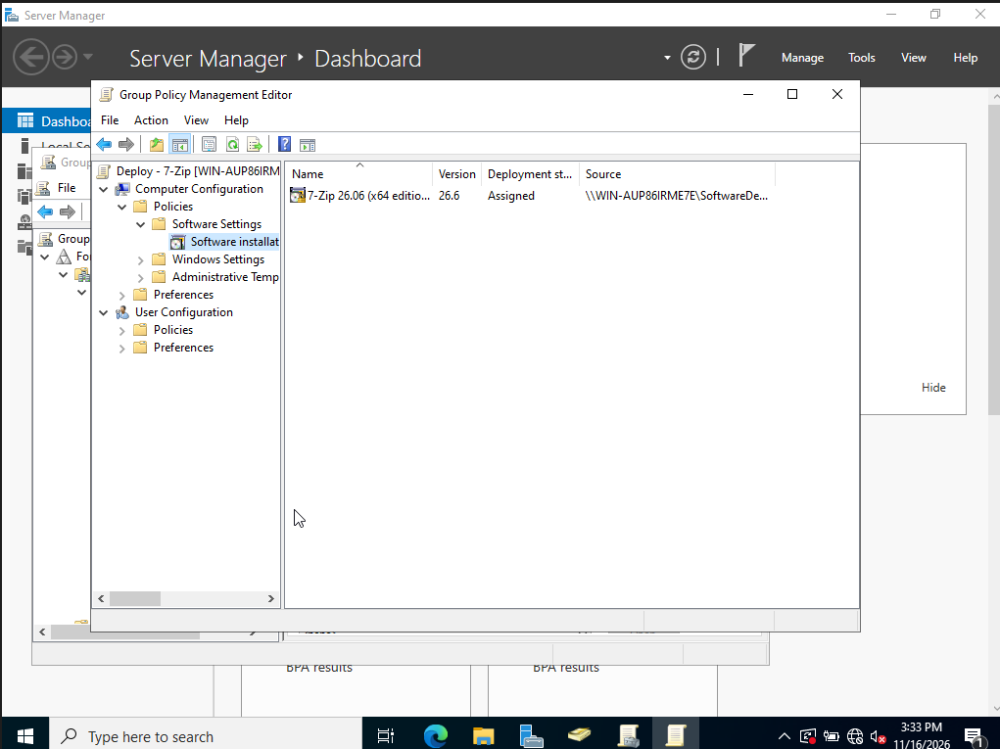
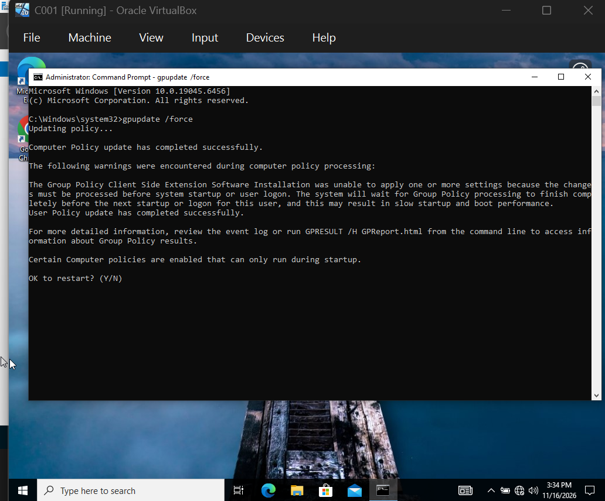
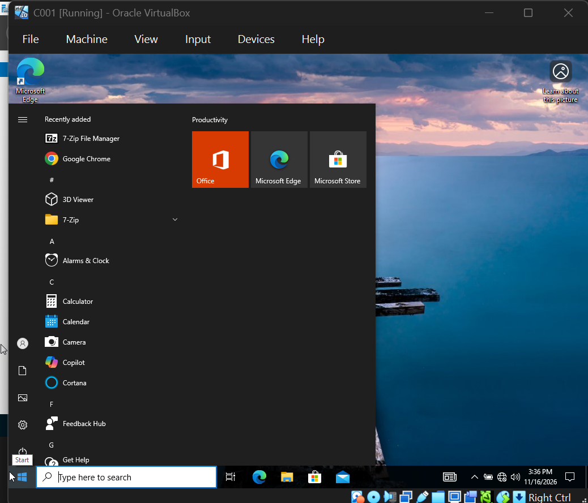
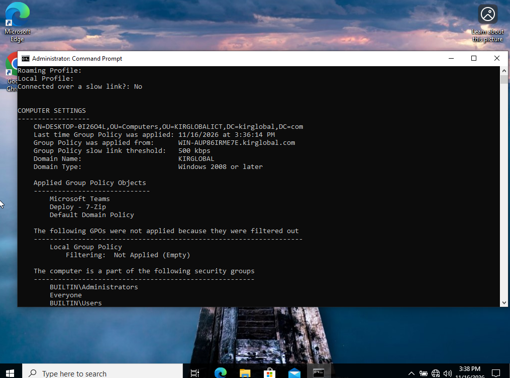
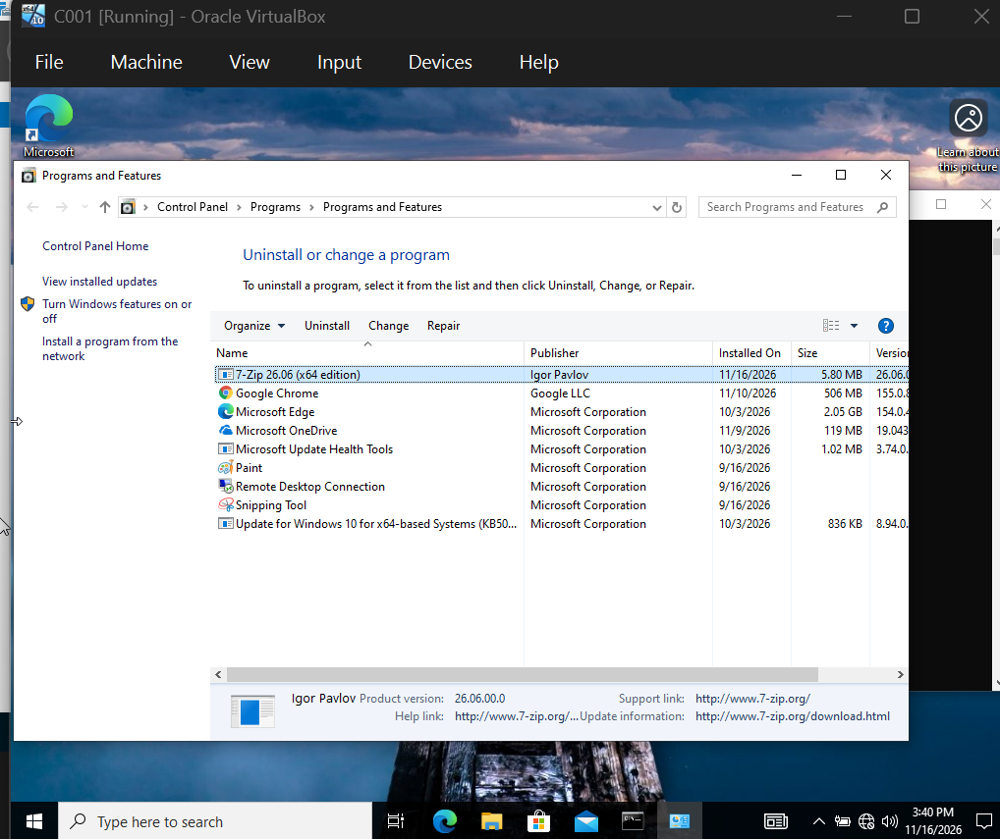

# TICKET-008 — Deploy 7-Zip to All Workstations via Group Policy

| Field | Value |
|---|---|
| **Ticket ID** | TICKET-008 |
| **Category** | Software Deployment / Group Policy |
| **Priority** | Medium |
| **Requested by** | IT Manager |
| **Assigned to** | Kirill Baev (IT Support) — performed with Tier 2 approval |
| **Status** | ✅ Resolved |
| **Environment** | Windows Server 2022 DC (`WIN-AUP86IRME7E`), Active Directory (`kirglobal.com`), Windows 10 client (`DESKTOP-0I26O4L`) |

---

## Request

> Staff need a file archiver to open `.zip` / `.7z` attachments. Please install **7-Zip**
> on all company workstations. Installing it manually on each PC is not scalable —
> deploy it centrally.

---

## Pre-checks

- Downloaded the official **MSI** package from [7-zip.org](https://www.7-zip.org/download.html):
  `7z2606-x64.msi`
  > GPO Software Installation supports **.msi only** — `.exe` installers can't be deployed this way.
- Confirmed workstation computer objects are located in `KIRGLOBALICT > Computers`
  (laptops in the `Notebooks` sub-OU)
- The DC has no internet access in the lab, so the installer was transferred via a
  VirtualBox shared folder

---

## Resolution Steps

### 1. Create a network share for the installer
Created `C:\SoftwareDeploy` on the DC and shared it as `\\WIN-AUP86IRME7E\SoftwareDeploy`.

| Permission type | Principal | Access |
|---|---|---|
| Share | Everyone | Read |
| NTFS | **Domain Computers** | Read & execute |



> **Why Domain Computers?** Computer-assigned software installs at boot, **before any user
> logs in**, under the computer's own account (SYSTEM). If computer accounts can't read the
> share, the installation silently fails.

Verified access from the client: `Win + R` → `\\WIN-AUP86IRME7E\SoftwareDeploy` ✅

### 2. Create and link the GPO
**Group Policy Management** → `kirglobal.com > KIRGLOBALICT > Computers` →
**Create a GPO in this domain, and Link it here...** → `Deploy - 7-Zip`

Linked to the `Computers` OU so it applies to all workstations there, and to the
`Notebooks` sub-OU through inheritance.



### 3. Add the software package
**Edit GPO** → `Computer Configuration → Policies → Software Settings → Software installation`
→ **New → Package...**

- Package path (UNC, **not** a local `C:\` path):
  `\\WIN-AUP86IRME7E\SoftwareDeploy\7z2606-x64.msi`
- Deployment method: **Assigned**



> **Assigned vs Published:** in *Computer Configuration* software can only be **Assigned**
> (installed automatically). *Published* is available only under *User Configuration*,
> where users install the app themselves from Programs and Features.

---

## Verification

### Apply policy on the client
```cmd
gpupdate /force
```
Software installation requires a restart — confirmed with **Y**.



After reboot, 7-Zip appeared in the Start menu under *Recently added*:



### Confirm the GPO was applied
```cmd
gpresult /r /scope computer
```
- Computer object: `CN=DESKTOP-0I26O4L,OU=Computers,OU=KIRGLOBALICT,DC=kirglobal,DC=com`
- `Deploy - 7-Zip` is listed under **Applied Group Policy Objects** ✅



### Confirm the installation
`appwiz.cpl` → **7-Zip 26.06 (x64 edition)**, Publisher: Igor Pavlov, Installed On: 11/16/2026 ✅



---

## Resolution Summary

Deployed 7-Zip to all domain workstations through a computer-assigned GPO
(`Deploy - 7-Zip`) linked to the `Computers` OU. The MSI is hosted on a network share
readable by `Domain Computers`. Verified on client `DESKTOP-0I26O4L` with `gpresult` and
Programs and Features. Any new workstation placed in the `Computers` OU will receive
7-Zip automatically on its next restart.

**Time to resolve:** ~30 min

## Notes / Troubleshooting Tips
- If the software doesn't install after the first reboot, reboot again —
  *Fast Logon Optimization* can delay computer policy processing by one restart.
- Common causes of failure: local path instead of UNC path, missing `Domain Computers`
  read permission, GPO linked to a user OU instead of a computer OU, `.exe` instead of `.msi`.
- Updating: add the new MSI version to the GPO and set it to **upgrade** the existing package.

## Skills Demonstrated
Group Policy Management · Software Installation (MSI, Assigned) · File share and NTFS permissions ·
OU design and GPO inheritance · `gpupdate` / `gpresult` · Centralized deployment at scale
