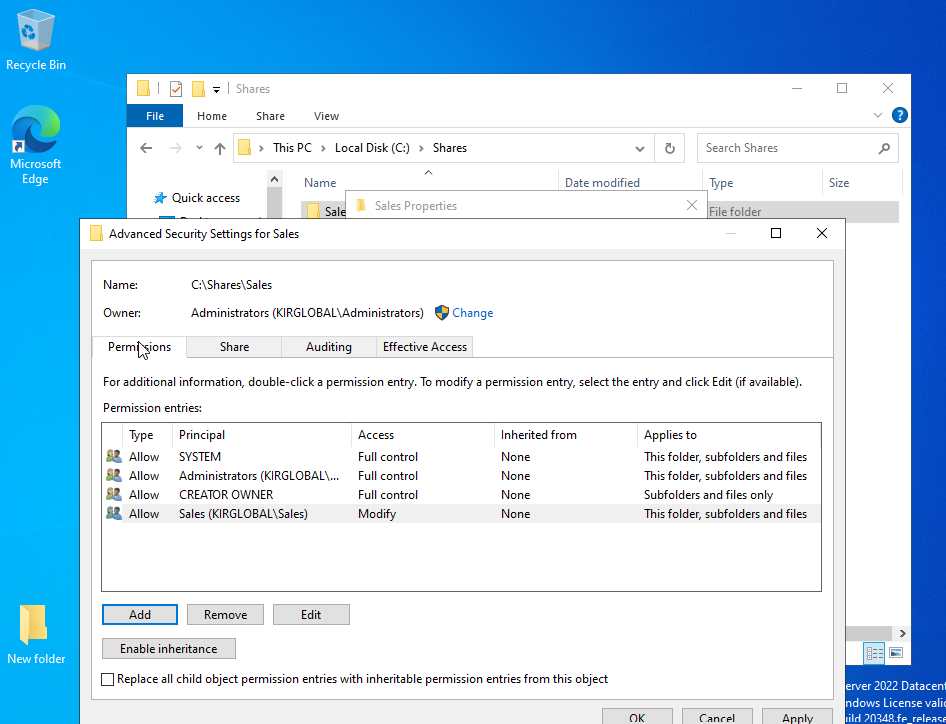
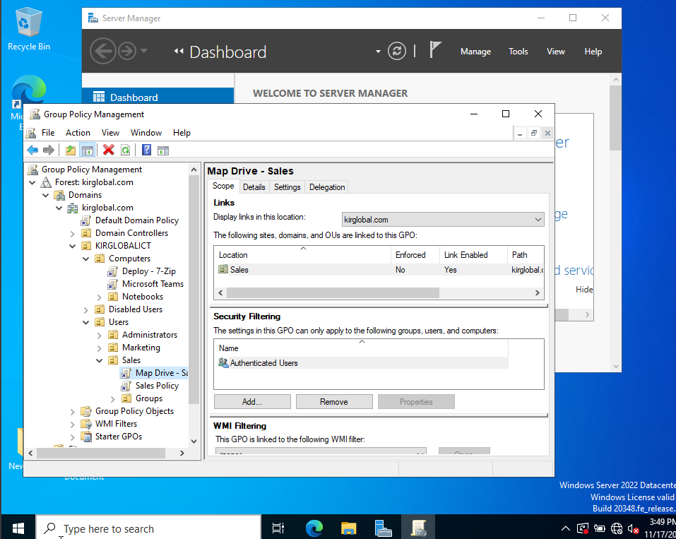
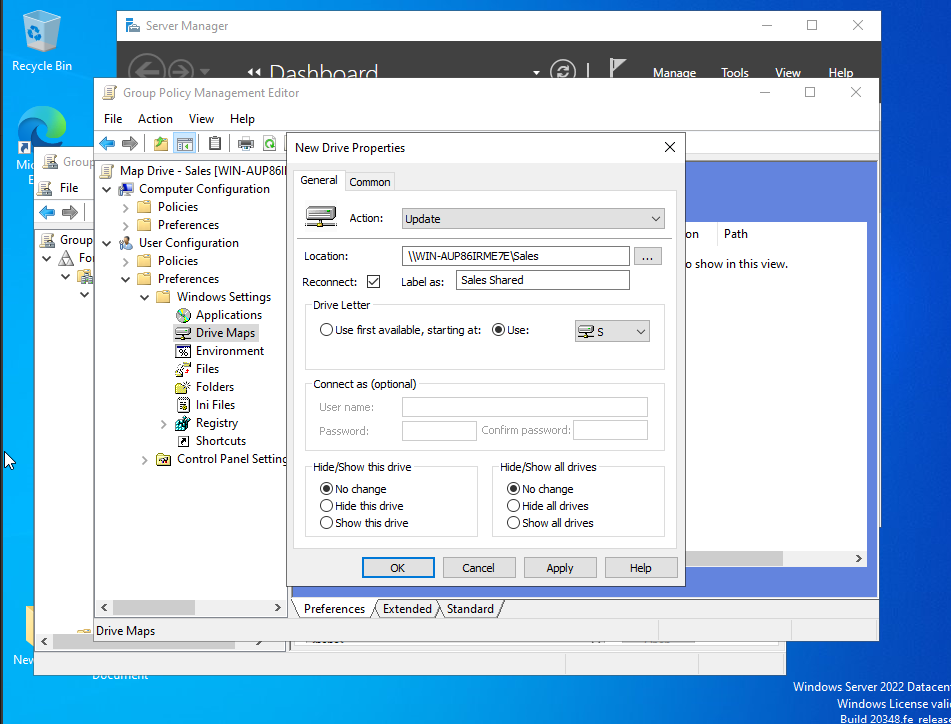
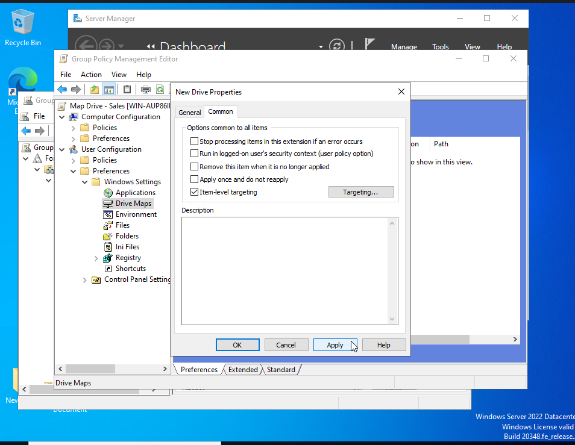
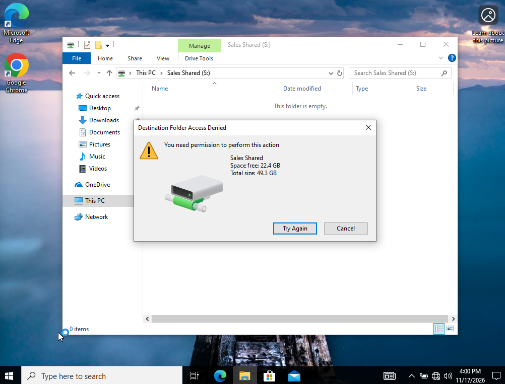
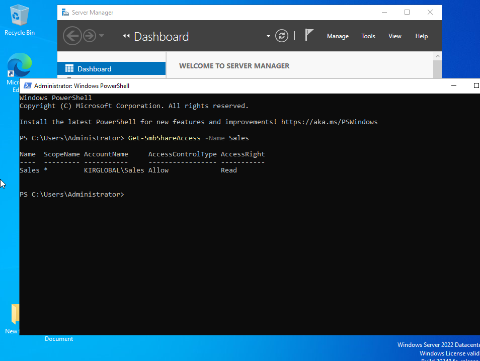
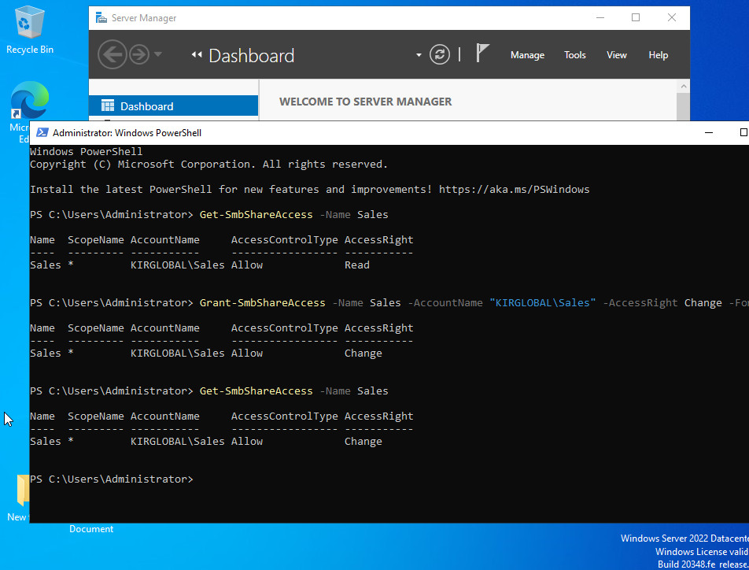
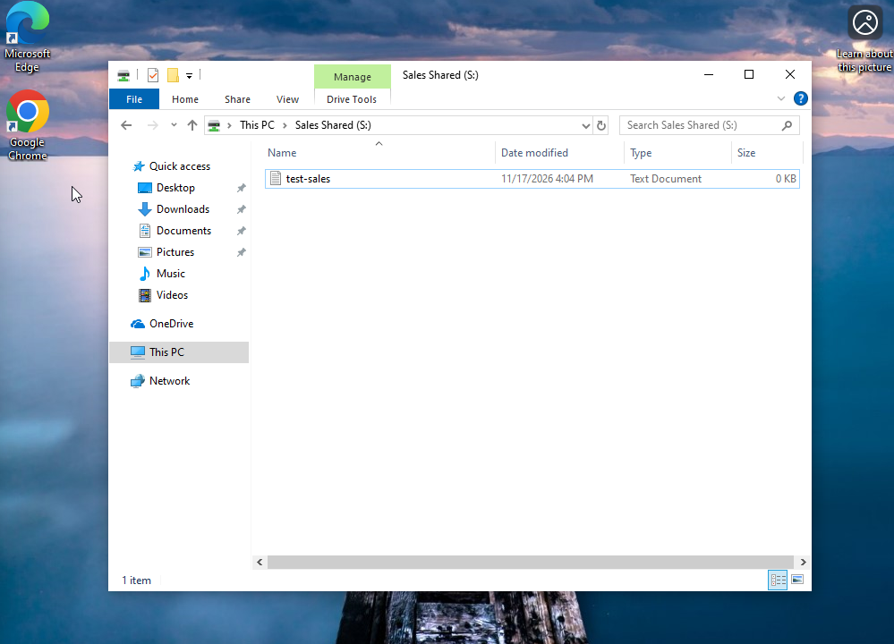
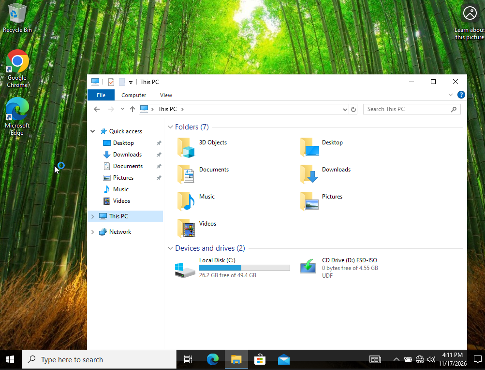
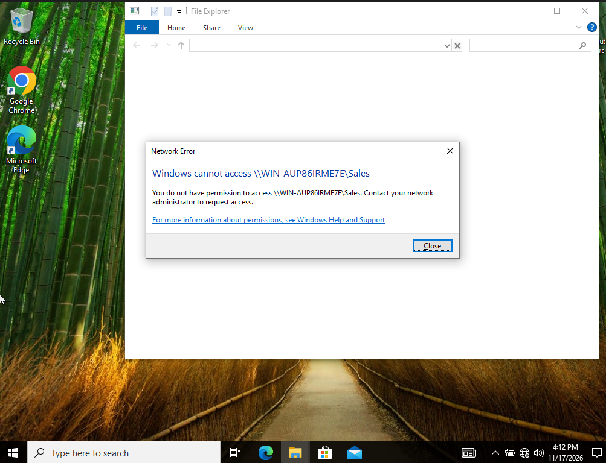

# TICKET-009 — Map Department Network Drive for Sales via Group Policy

| Field | Value |
|---|---|
| **Ticket ID** | TICKET-009 |
| **Category** | File Shares / Group Policy |
| **Priority** | Medium |
| **Requested by** | Sales Department Manager |
| **Assigned to** | Kirill Baev (IT Support) |
| **Status** | ✅ Resolved |
| **Environment** | Windows Server 2022 DC (`WIN-AUP86IRME7E`), Active Directory (`kirglobal.com`), domain-joined Windows 10 client |

---

## Request

> The Sales team needs a shared folder for proposals and price lists.
> It should appear automatically as a drive for everyone in Sales,
> and **only** Sales staff should be able to access it.

---

## Pre-checks

- Sales users are located in `KIRGLOBALICT > Users > Sales`
- Security group `KIRGLOBAL\Sales` exists (`Sales > Groups`) and contains the Sales staff
- Test users: **Simon Stark** (Sales member) and **Kirill Baev** (not in Sales) for a negative test

---

## Resolution Steps

### 1. Create the department folder with restricted NTFS permissions
Created `C:\Shares\Sales` on the DC and shared it as `\\WIN-AUP86IRME7E\Sales`.

NTFS (Security → Advanced):
- **Disabled inheritance** and converted inherited permissions to explicit
- Removed `Users (KIRGLOBAL\Users)` — otherwise every domain user could read the folder
- Added `KIRGLOBAL\Sales` → **Modify**

| Principal | Access |
|---|---|
| SYSTEM | Full control |
| Administrators | Full control |
| CREATOR OWNER | Full control (subfolders and files) |
| **Sales** | **Modify** |



### 2. Create and link the GPO
**Group Policy Management** → `KIRGLOBALICT > Users > Sales` →
**Create a GPO in this domain, and Link it here...** → `Map Drive - Sales`

> Drive mappings are a **user** setting, so the GPO is linked to the OU containing the
> **user** accounts — unlike software deployment (TICKET-008), which targets computer OUs.
> A separate GPO was created instead of adding to the existing `Sales Policy`:
> one GPO per purpose makes troubleshooting and rollback easier.



### 3. Configure the drive mapping (Group Policy Preferences)
`User Configuration → Preferences → Windows Settings → Drive Maps → New → Mapped Drive`

| Setting | Value |
|---|---|
| Action | **Update** (creates the drive if missing, fixes it if changed) |
| Location | `\\WIN-AUP86IRME7E\Sales` |
| Reconnect | ☑ |
| Label as | Sales Shared |
| Drive letter | **S:** |



**Common → ☑ Item-level targeting → Targeting...:** *the user is a member of the security group* `KIRGLOBAL\Sales` —
an extra safeguard so only Sales members get the drive, even if another account ends up in the OU.



---

## Issue Found During Testing

Signed in on the client as **Simon Stark** → `gpupdate /force` → signed out and back in.
The **S:** drive mapped successfully, but creating a file failed:
*"Destination Folder Access Denied — You need permission to perform this action."*



### Diagnosis
A shared folder has **two permission layers — Share and NTFS — and the most restrictive one wins**.
NTFS allowed *Modify*, so the share level was checked:

```powershell
Get-SmbShareAccess -Name Sales
```
```
Name  ScopeName AccountName     AccessControlType AccessRight
----  --------- -----------     ----------------- -----------
Sales *         KIRGLOBAL\Sales Allow             Read
```



**Root cause:** when the group was added to the share permissions, only the default **Read**
right was granted. Effective access = Read (Share) ∩ Modify (NTFS) = **Read**.

### Fix
```powershell
Grant-SmbShareAccess -Name Sales -AccountName "KIRGLOBAL\Sales" -AccessRight Change -Force
Get-SmbShareAccess -Name Sales   # AccessRight : Change
```



---

## Verification

### ✅ Sales member (Simon Stark)
- **S: (Sales Shared)** is mapped automatically at logon
- Test file `test-sales.txt` created successfully



### ✅ Non-Sales user (Kirill Baev)
- No S: drive in *This PC* — the GPO / item-level targeting does not apply



- Direct access to `\\WIN-AUP86IRME7E\Sales` is denied:
  *"You do not have permission to access \\WIN-AUP86IRME7E\Sales."*



---

## Resolution Summary

Created a restricted department share for Sales (NTFS *Modify* and Share *Change* for the
`Sales` group only) and mapped it as **S:** through a dedicated GPO with item-level targeting.
During testing, write access failed because the share permission was left at the default *Read*;
diagnosed with `Get-SmbShareAccess` and fixed with `Grant-SmbShareAccess`.
Verified that Sales members get the drive with write access and other users are denied.

**Time to resolve:** ~35 min

## Lessons Learned
- Always check **both** Share and NTFS permissions — effective access is the most restrictive of the two
- When adding a group to share permissions, the default is **Read** only
- Test with a member **and** a non-member account before closing the ticket

## Skills Demonstrated
Group Policy Preferences (Drive Maps, Item-level targeting) · NTFS vs Share permissions ·
Least privilege · PowerShell (`Get-SmbShareAccess`, `Grant-SmbShareAccess`) ·
Troubleshooting and root cause analysis · Positive and negative testing
