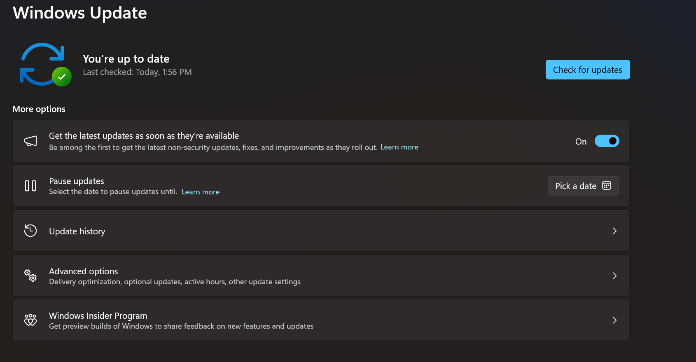
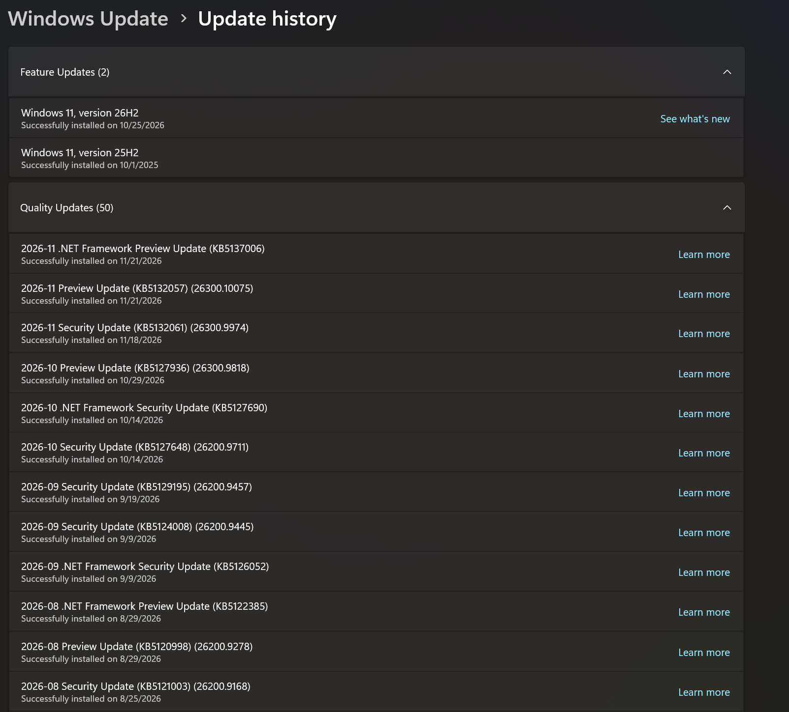
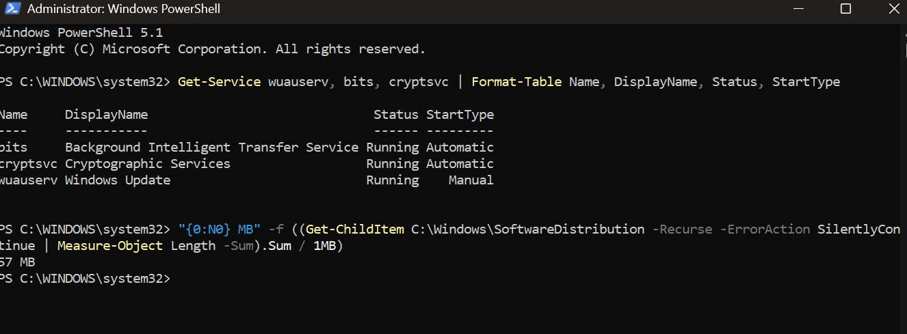
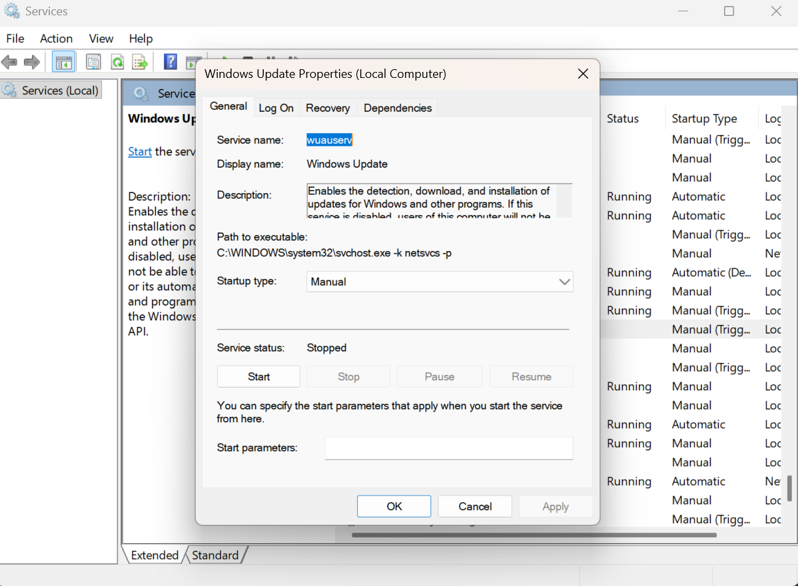
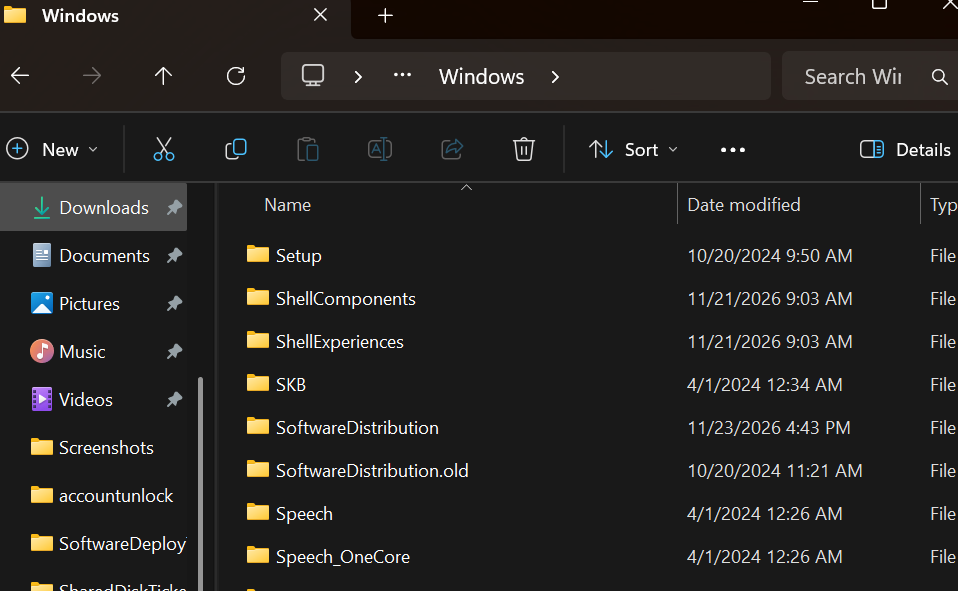
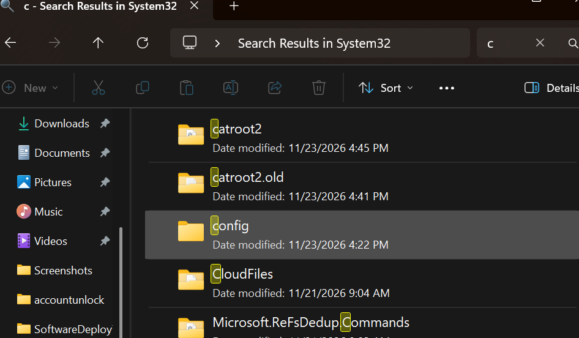
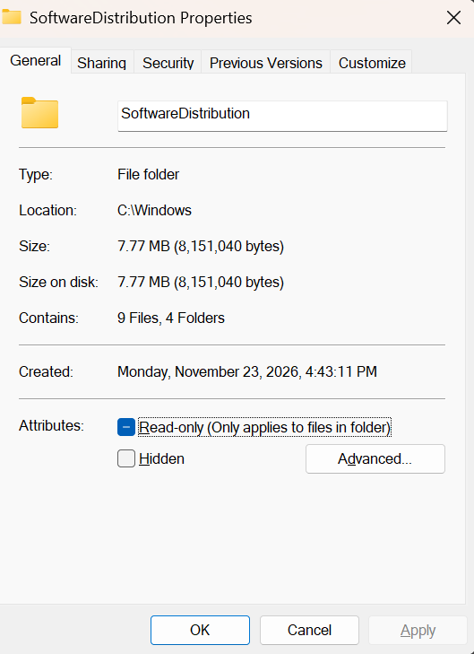
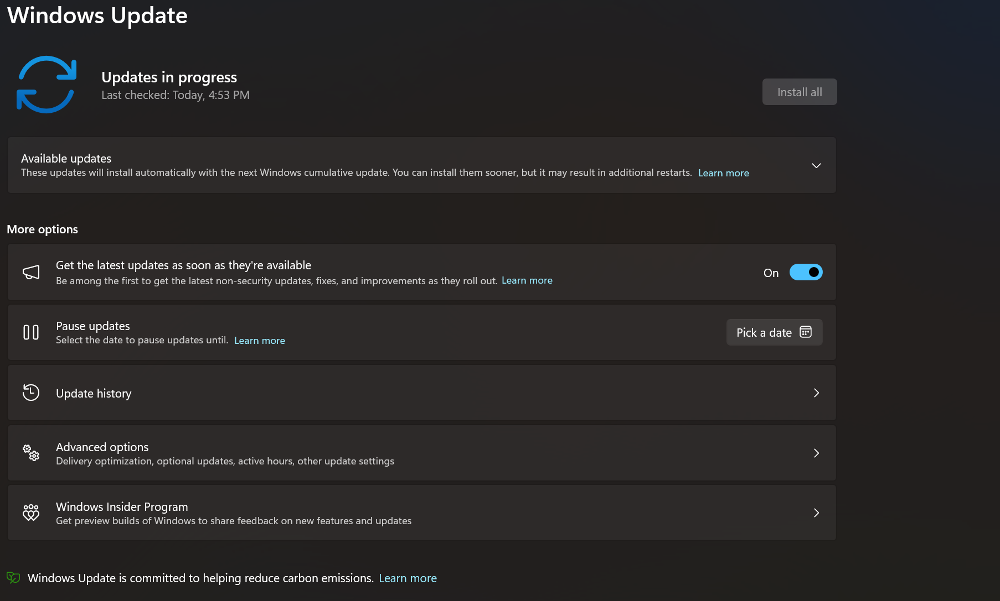

# TICKET-010 — Windows Update Fails / Stuck: Reset Windows Update Components

| Field | Value |
|---|---|
| **Ticket ID** | TICKET-010 |
| **Category** | OS / Windows Update |
| **Priority** | Medium |
| **Requested by** | End user |
| **Assigned to** | Kirill Baev (IT Support, Tier 1) |
| **Status** | ✅ Resolved |
| **Environment** | Windows 11 (26H2) workstation |

---

## Request

> *"Windows Update keeps getting stuck on 'Checking for updates' / an update fails to download
> and retries every day. Can you take a look?"*

> **Lab note:** the workstation was healthy at the time of testing, so the standard
> Windows Update component reset was performed and verified as a remediation procedure.

---

## Diagnosis

### 1. Current Windows Update status
**Settings → Windows Update**

### 2. Update history
**Settings → Windows Update → Update history** — checked for updates with a *Failed* status
or an error code (e.g. `0x80070002`, `0x8024xxxx`).

### 3. Update services and cache size
Checked that the three services Windows Update depends on are running, and the size of the
local update cache (**57 MB**).

| Service | Role |
|---|---|
| **Windows Update** (`wuauserv`) | Detects, downloads and installs updates |
| **Background Intelligent Transfer Service** (`bits`) | Downloads update files in the background |
| **Cryptographic Services** (`cryptsvc`) | Verifies update signatures (catroot2) |

> `wuauserv` showing **Manual** is normal — it is trigger-started when Windows checks for updates.

---

## Resolution — Reset Windows Update Components

**Why:** `C:\Windows\SoftwareDistribution` is the Windows Update **cache** (downloaded update files
and the update database). If a download is interrupted or a file gets corrupted, Windows keeps
reusing the broken file and the update fails again and again. Resetting the cache forces
Windows to rebuild it and download everything clean.
Installed updates and personal files are **not** affected — only the *Update history* list is reset.

### Step 1. Stop the update services
`Win + R` → `services.msc` → **Stop**:
- Windows Update
- Background Intelligent Transfer Service
- Cryptographic Services

> Stopping Cryptographic Services also stops the dependent **Application Identity** service
> (used by AppLocker). This is expected — it is trigger-started and comes back automatically when needed.

### Step 2. Rename (not delete) the cache folders
In File Explorer:

| Folder | Renamed to |
|---|---|
| `C:\Windows\SoftwareDistribution` | `SoftwareDistribution.old` |
| `C:\Windows\System32\catroot2` | `catroot2.old` |

Renaming instead of deleting keeps a rollback option.

> The *Date modified* of `SoftwareDistribution.old` shows an older date — Explorer displays the date
> the folder's contents last changed, not the rename time. The **new** `SoftwareDistribution`
> created at 4:43 PM confirms the rename worked.

**Issue encountered:** renaming `catroot2` failed with *"Folder In Use"* — Cryptographic Services
restarts almost immediately because other processes (e.g. the browser checking certificates) call it.
**Fix:** stopped Cryptographic Services again in `services.msc` and **immediately** retried the rename
in File Explorer (*Try Again*) before the service could restart.

### Step 3. Start the services again
`services.msc` → **Start**: Cryptographic Services → Background Intelligent Transfer Service → Windows Update

---

## Verification

- A **new, clean** `SoftwareDistribution` folder was created automatically (created today, 7.77 MB
  vs. 57 MB before); a new `catroot2` was also rebuilt by the service ✅

- **Settings → Windows Update → Check for updates** completes without errors and new
  updates are detected and downloading ✅

---

## Resolution Summary

Reset Windows Update components: stopped the update services, renamed the
`SoftwareDistribution` and `catroot2` caches, restarted the services, and verified that
Windows rebuilt both folders and successfully checked for and downloaded updates.

**Time to resolve:** ~15 min

## Notes
- After a few days of successful updates, the `.old` folders can be deleted to free space.
- **If a specific update keeps failing**, it can be installed manually: search its KB number in the
  [Microsoft Update Catalog](https://www.catalog.update.microsoft.com), download the `.msu` file and run it.
- **Disabling Windows Update is not recommended** — it leaves the machine without security patches.
  In a company, updates are **paused or deferred** instead (*Settings → Pause updates*, or centrally
  via Group Policy / WSUS / Intune), so IT can test patches before they roll out.

## Skills Demonstrated
Windows Update troubleshooting · Windows Services (`services.msc`) · Service dependencies ·
File system maintenance · Patch management best practices
