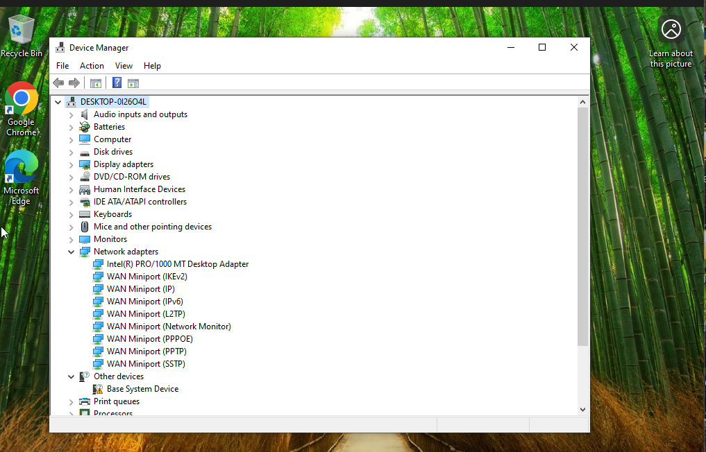
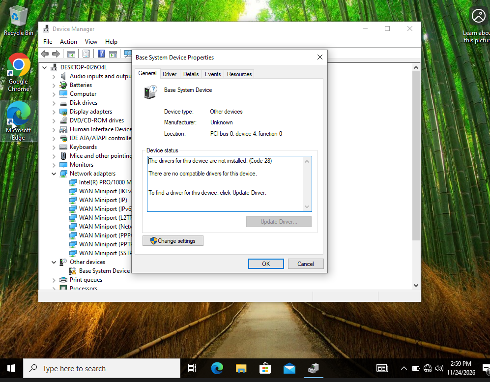
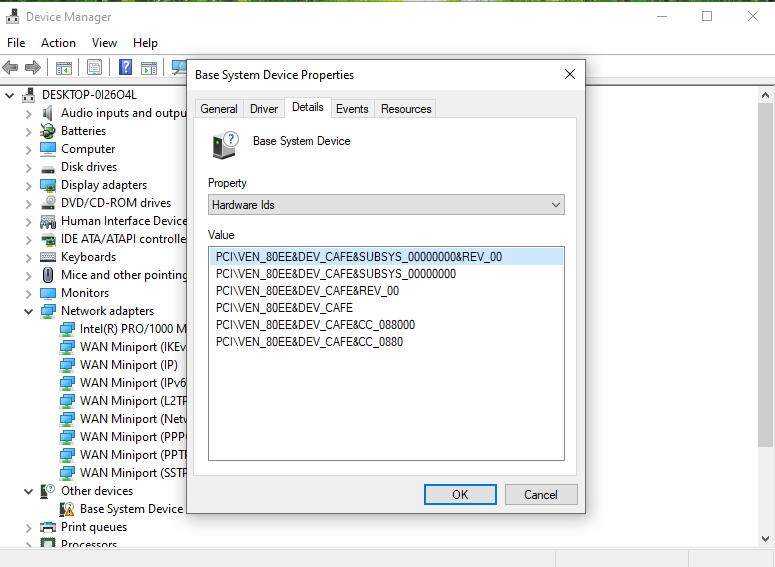
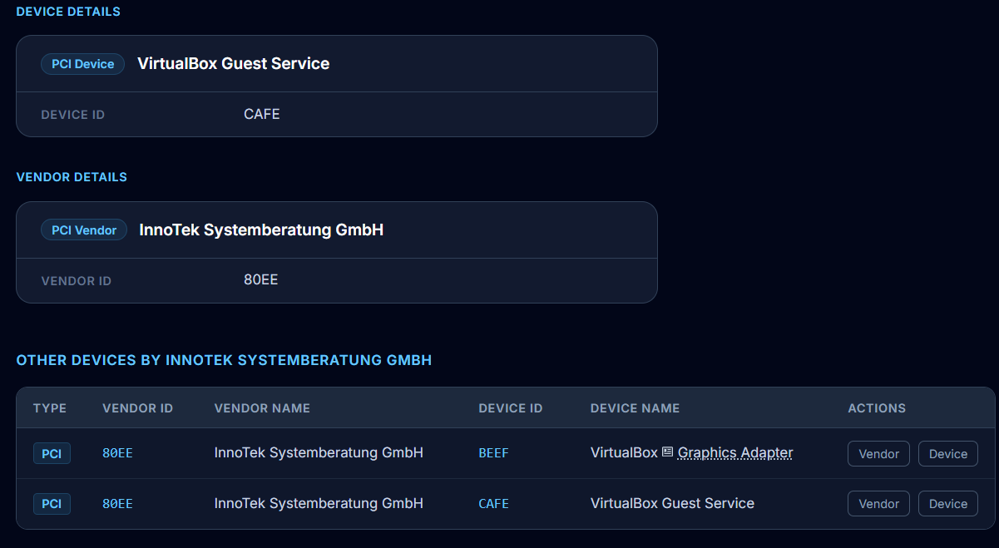
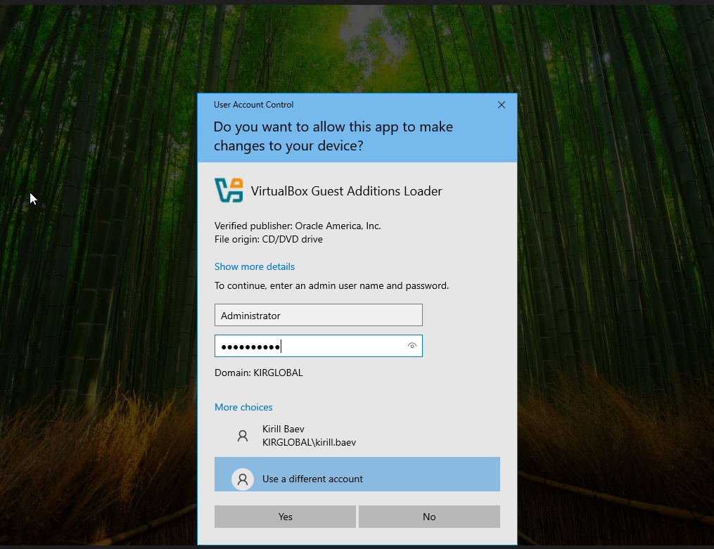
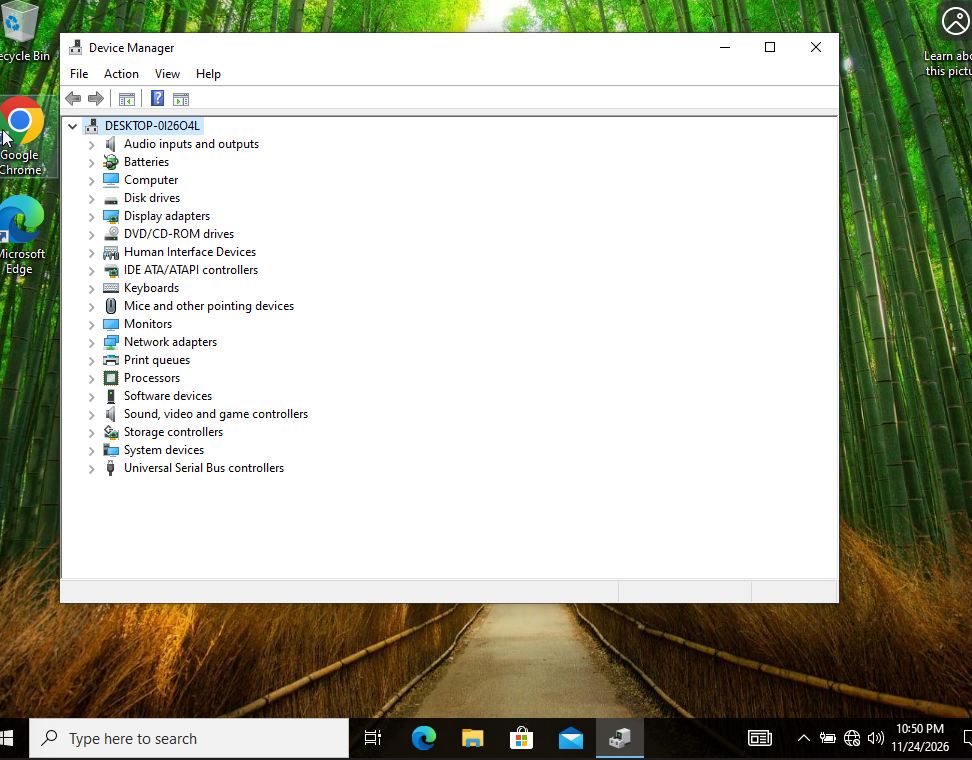
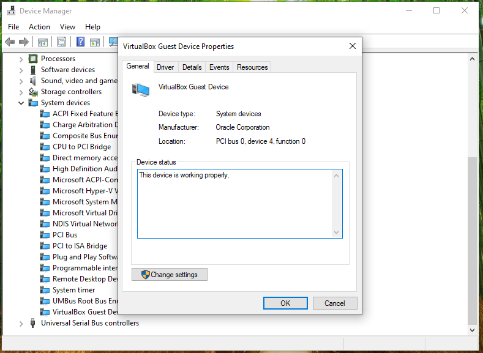
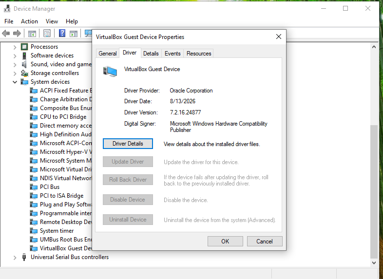

# TICKET-011 — Unknown Device / Missing Driver (Code 28)

| Field | Value |
|---|---|
| **Ticket ID** | TICKET-011 |
| **Category** | Hardware / Drivers |
| **Priority** | Low–Medium |
| **Requested by** | End user |
| **Assigned to** | Kirill Baev (IT Support, Tier 1) |
| **Status** | ✅ Resolved |
| **Environment** | Domain-joined Windows 10 client (`DESKTOP-0I26O4L`) running in VirtualBox, domain `kirglobal.com` |

---

## Request

> *"Some features on my computer don't work properly and Windows shows an unknown device.
> Can you check if a driver is missing?"*

---

## Diagnosis

### 1. Device Manager
`Win + R` → `devmgmt.msc` — an unknown **Base System Device** under **Other devices**
with a yellow warning icon.



### 2. Device status
**Properties → General** → *"The drivers for this device are not installed. (Code 28)"*



### 3. Identify the device by Hardware ID
**Properties → Details → Hardware Ids**

```
PCI\VEN_80EE&DEV_CAFE
```

- `VEN` = **Vendor ID** (manufacturer)
- `DEV` = **Device ID** (specific device)



### 4. Look up the IDs
The affected PC had no internet access, so the IDs were looked up from a technician workstation
on [devicehunt.com](https://devicehunt.com):

| ID | Result |
|---|---|
| Vendor `80EE` | InnoTek Systemberatung GmbH (Oracle VirtualBox) |
| Device `CAFE` | **VirtualBox Guest Service** |



**Root cause:** the device's driver package (VirtualBox Guest Additions) was never installed.
In a physical environment this would typically be a chipset, card reader or other device whose
driver comes from the laptop manufacturer.

> ⚠️ **Security note:** driver lookup sites often show ads like *"Install Now — driver updater"*.
> These frequently lead to unwanted software or malware. Drivers should only come from the
> **official manufacturer** (Dell, HP, Lenovo, Intel, etc.) or **Windows Update**.

---

## Resolution

### Issue encountered — first attempt
Tried to extract the driver files from the installer with `/extract` to install them manually.
In this version the installer ignored the extraction switch and started writing to
`C:\Windows\System32` (the default working directory of an elevated Command Prompt).
**Aborted immediately**, and switched to the official installer package instead.

> **Lesson:** always check where a tool writes files — an admin Command Prompt starts in `System32`.

### Install the vendor driver package
1. Attached the **VirtualBox Guest Additions** media (official vendor package) to the VM
2. Running the installer as the logged-on user failed: *"You need administrator rights"* —
   standard users don't have admin rights (**least privilege**)

3. **Right-click → Run as administrator** → elevated with the **technician's domain admin
   credentials** via UAC (the user was not given admin rights).
   UAC confirms the package is digitally signed — **Verified publisher: Oracle America, Inc.**



4. Installed and rebooted

---

## Verification

- **Other devices** category is gone — no more warning icons ✅



- Device now recognized as **VirtualBox Guest Device** under **System devices** ✅

- Device status: *"This device is working properly"* ✅



- Driver details ✅

| Field | Value |
|---|---|
| Driver Provider | Oracle Corporation |
| Driver Version | 7.2.16.24877 |
| Digital Signer | Microsoft Windows Hardware Compatibility Publisher (WHQL-certified) |



---

## Resolution Summary

An unknown *Base System Device* (Code 28) was identified via its Hardware ID
(`VEN_80EE&DEV_CAFE`) as the VirtualBox Guest Service. The vendor's signed driver package was
installed with elevated technician credentials, and the device was verified as working with a
WHQL-signed driver.

**Time to resolve:** ~30 min

## Driver Troubleshooting Cheat Sheet
| Situation | Action in Device Manager |
|---|---|
| Unknown device / Code 28 | Find Hardware ID → get driver from the manufacturer |
| Device stopped working after a driver update | **Roll Back Driver** |
| Driver corrupted | **Uninstall device** → *Action → Scan for hardware changes* |
| Install a driver from downloaded files | **Update driver → Browse my computer** → folder with the `.inf` file |

## Skills Demonstrated
Device Manager · Hardware ID (VEN/DEV) identification · Driver installation and verification ·
Driver signing (WHQL) · UAC elevation and least privilege · Safe driver sourcing
