# TICKET-012 — Enable Secure Remote Desktop (RDP) Access for IT Support via Group Policy

| Field | Value |
|---|---|
| **Ticket ID** | TICKET-012 |
| **Category** | Remote Support / Group Policy / Security |
| **Priority** | Medium |
| **Requested by** | IT Manager |
| **Assigned to** | Kirill Baev (IT Support) |
| **Status** | ✅ Resolved |
| **Environment** | Windows Server 2022 DC, Active Directory (`kirglobal.com`), Windows 10 client (`DESKTOP-0I26O4L`) |

---

## Request

> The IT team needs to connect remotely to employee workstations to resolve issues.
> Enable Remote Desktop on all workstations, but **only IT Support staff** should be able to connect —
> regular employees must not have RDP access.

---

## Pre-checks

- My own account is a member of **Administrators, Enterprise Admins and Schema Admins** — admins can
  RDP anywhere by default, so it can't be used to test least-privilege access.
- Created a dedicated technician account **Alex Morgan** (`amorgan`, *IT Support Specialist*) with
  **no admin rights** — only `Domain Users` + the new IT group.

> **Best practice:** a technician's daily account should not be a domain/enterprise admin.
> Privileged rights belong on a separate admin account used only when needed.

### Security group
Created `IT-Support` (Global, Security) in `KIRGLOBALICT > Users > Administrators` → member: Alex Morgan

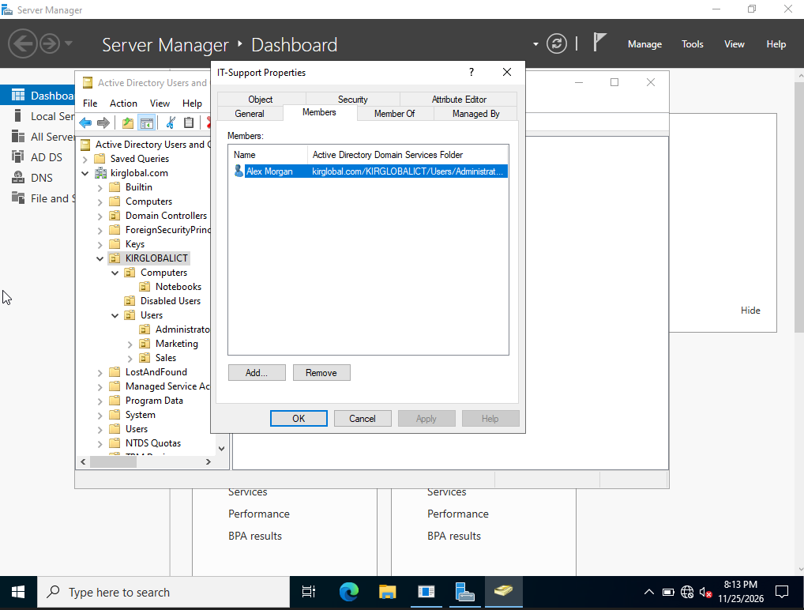

---

## Resolution — GPO `Enable RDP - IT Support`

Linked to `KIRGLOBALICT > Computers` (RDP is a **computer** setting, so it targets the computer OU).

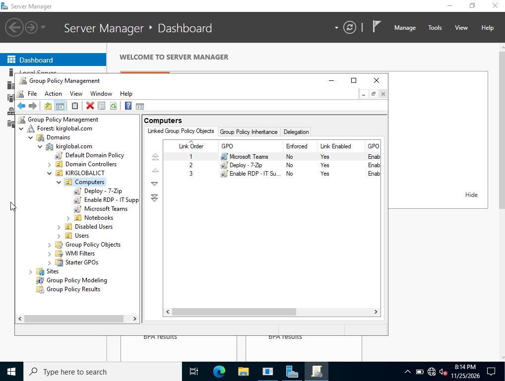

All settings under `Computer Configuration → Policies → Administrative Templates`:

### 1. Enable Remote Desktop
`Windows Components → Remote Desktop Services → Remote Desktop Session Host → Connections`
→ **Allow users to connect remotely by using Remote Desktop Services** → *Enabled*

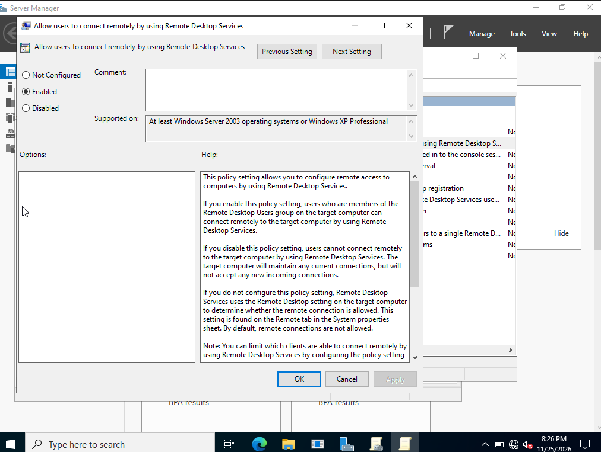

### 2. Require Network Level Authentication (NLA)
`... → Remote Desktop Session Host → Security`
→ **Require user authentication for remote connections by using NLA** → *Enabled*

> NLA verifies credentials **before** a remote session is created, reducing the attack surface
> and resource usage from unauthenticated connection attempts.

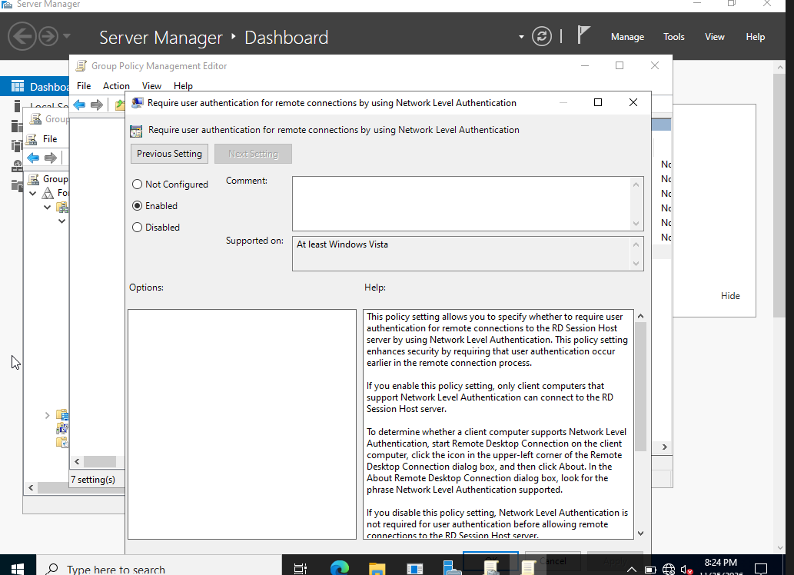

### 3. Open the firewall — Domain profile only
`Network → Network Connections → Windows Defender Firewall → Domain Profile`
→ **Allow inbound Remote Desktop exceptions** → *Enabled*, allowed from: `localsubnet`

> Port **TCP 3389** is opened only when the PC is on the corporate (domain) network and only for the
> local subnet — not on public/home networks. In production this would be restricted further to
> IT workstations or a jump host.

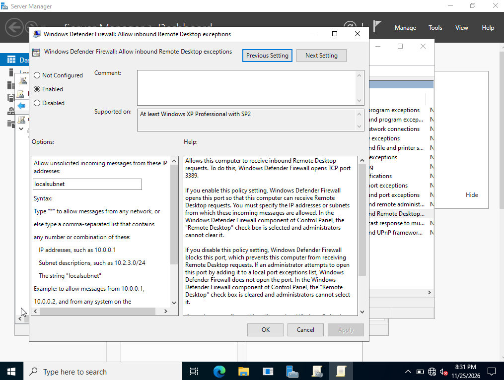

### 4. Grant RDP rights to IT-Support only
`Computer Configuration → Preferences → Control Panel Settings → Local Users and Groups`
→ New Local Group → **Update** `Remote Desktop Users (built-in)` → add `KIRGLOBAL\IT-Support`

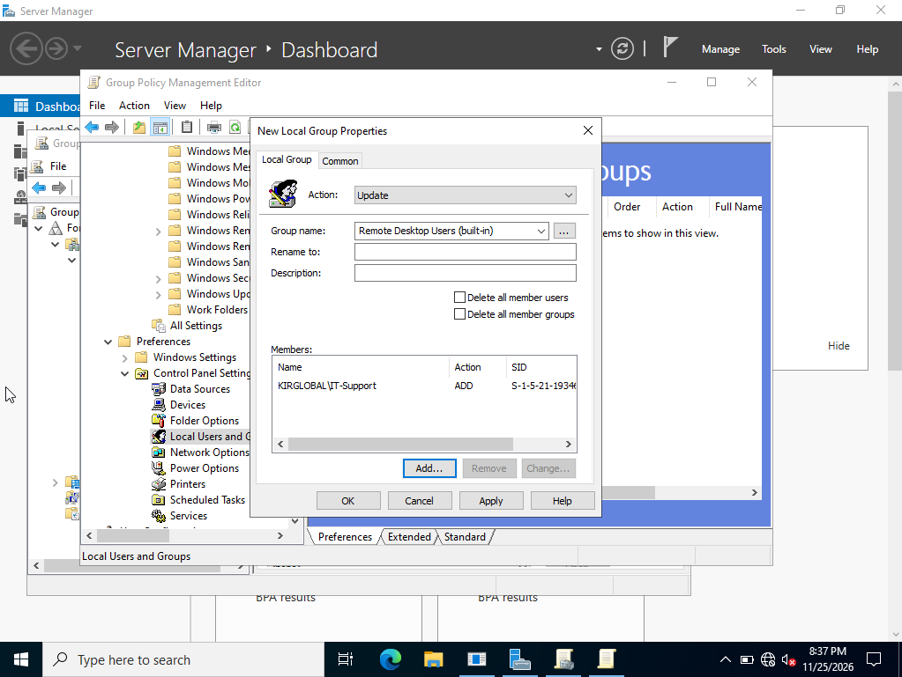

---

## Applying the Policy on the Client

```cmd
gpupdate /force
gpresult /r /scope computer
```
`Enable RDP - IT Support` is listed under **Applied Group Policy Objects**.

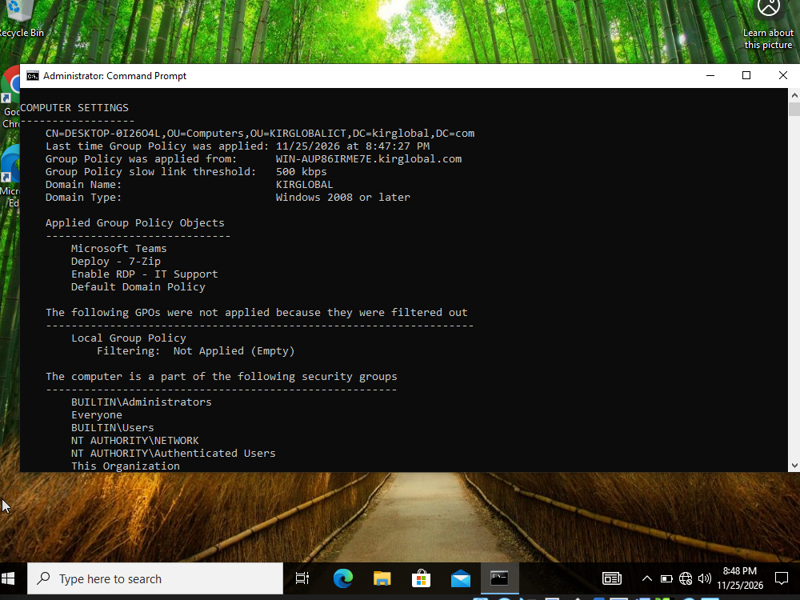

Local group check (`lusrmgr.msc` → Groups → Remote Desktop Users): contains `KIRGLOBAL\IT-Support`.

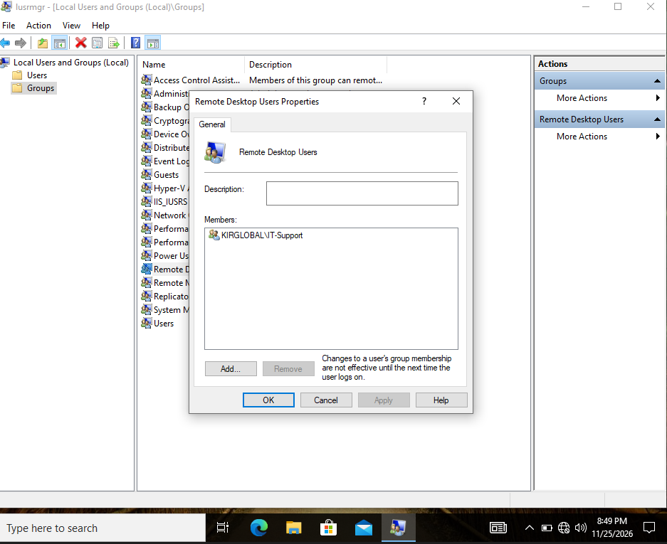

Network profile check: **Domain networks — Connected (kirglobal.com)**, so the Domain-profile firewall
rule applies. The banner *"some settings are managed by your system administrator"* confirms the GPO.

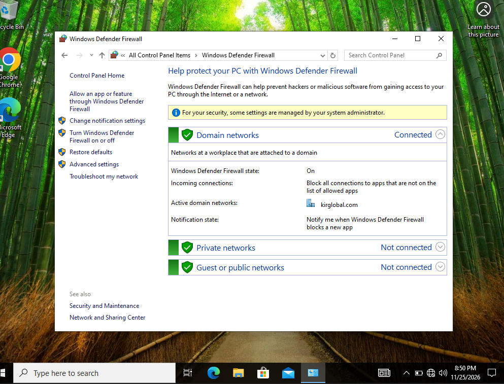

---

## Issues Found During Testing

### Issue 1 — "Remote Desktop can't find the computer"
**Cause:** typo in the hostname — typed `DESKTOP-0I2604L` (zero) instead of `DESKTOP-0I26O4L`
(letter **O**). **Fix:** used the exact name from AD (or the FQDN `DESKTOP-0I26O4L.kirglobal.com`).
Name resolution can be verified with `nslookup <hostname>`.

### Issue 2 — "You must change your password before logging on the first time"
NLA prompts for credentials before the session starts, but the new technician account had
*User must change password at next logon* set:

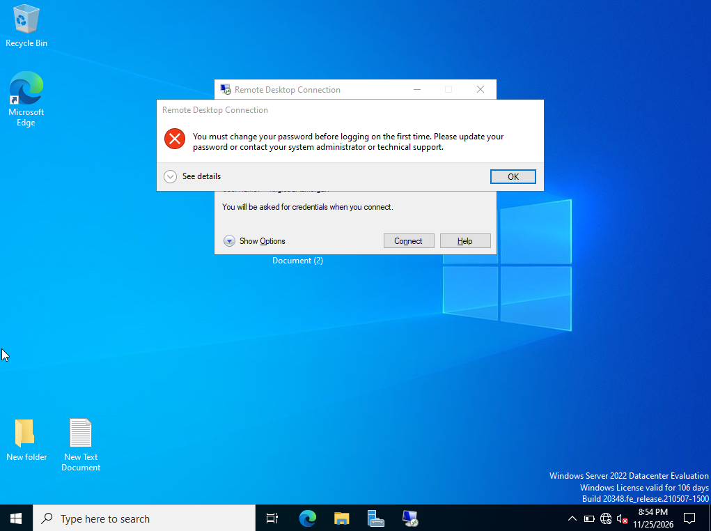

**Cause:** with NLA, Windows can't show the password-change screen over RDP, so the login is refused.
**Fix:** reset the password in ADUC without the *must change* flag (alternatively, the user signs in
locally once and changes it).

---

## Verification

### ✅ Positive test — IT Support (Alex Morgan)
`mstsc` → `DESKTOP-0I26O4L` → `kirglobal\amorgan`

Windows warned that another user was signed in and would be **disconnected** — expected RDP behavior
on client Windows (one interactive session at a time):

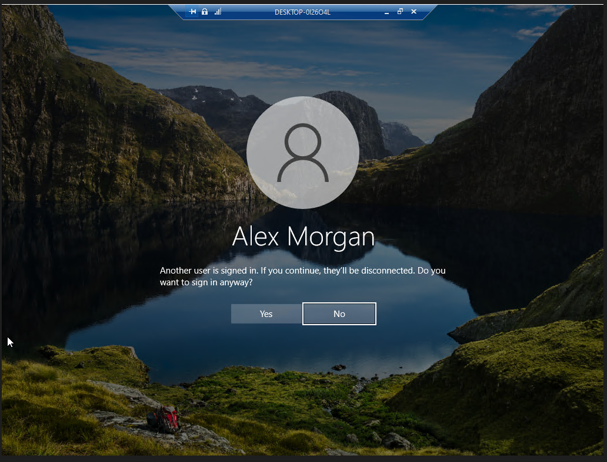

Connected successfully — `whoami` = `kirglobal\amorgan`, `hostname` = `DESKTOP-0I26O4L`.
Alex Morgan has **no admin rights**, so access was granted only through the GPO and the `IT-Support` group.

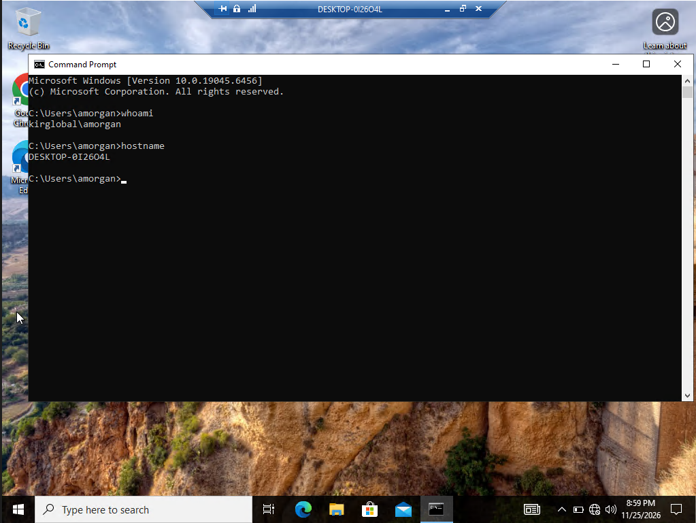

### ✅ Negative test — regular employee (Simon Stark, Sales)
*"The connection was denied because the user account is not authorized for remote login."*

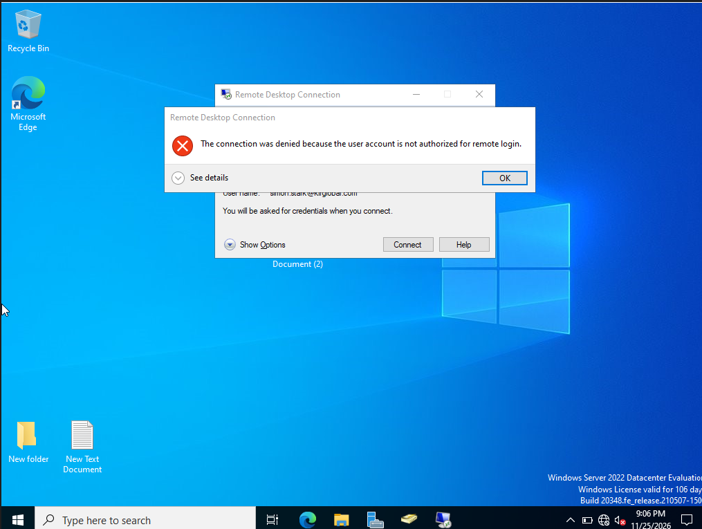

---

## Resolution Summary

Enabled Remote Desktop on all workstations in the `Computers` OU via a single GPO: RDP turned on,
NLA required, firewall opened only on the domain profile for the local subnet, and RDP rights granted
only to the `IT-Support` group. Verified that a non-admin IT technician can connect and a regular
employee is denied. Two issues found during testing (hostname typo, NLA + forced password change)
were diagnosed and resolved.

**Time to resolve:** ~45 min

---

## Remote Support Tools — When to Use What

| | **RDP** | **Remote Assistance** | **Quick Assist** |
|---|---|---|---|
| User sees the screen | ❌ user's session is locked / disconnected | ✅ | ✅ |
| User consent required | ❌ | ✅ | ✅ |
| Network | internal network / VPN | internal network | over the internet, no open ports |
| How to connect | computer name + credentials | invitation file + password | 6-digit code from the technician |
| Best for | servers, unattended PCs, admin tasks | legacy — replaced by Quick Assist | helping a user live, showing them the fix |

**Rule of thumb:** user needs to watch / be shown → **Quick Assist**. Nobody at the PC, just fix
or configure → **RDP**.

> ⚠️ **Security notes**
> - Never expose RDP (3389) directly to the internet — it's one of the most common ransomware entry
>   points. Use VPN, NLA, and restrict access to specific groups.
> - Quick Assist is widely abused in **tech-support scams** — users should never give an access code
>   to someone who called them unexpectedly.

## Skills Demonstrated
Group Policy (Administrative Templates, Preferences) · Remote Desktop / NLA · Windows Defender Firewall ·
Least privilege & security groups · `gpupdate` / `gpresult` · Troubleshooting (name resolution, NLA) ·
Positive and negative testing · Remote support tool selection
